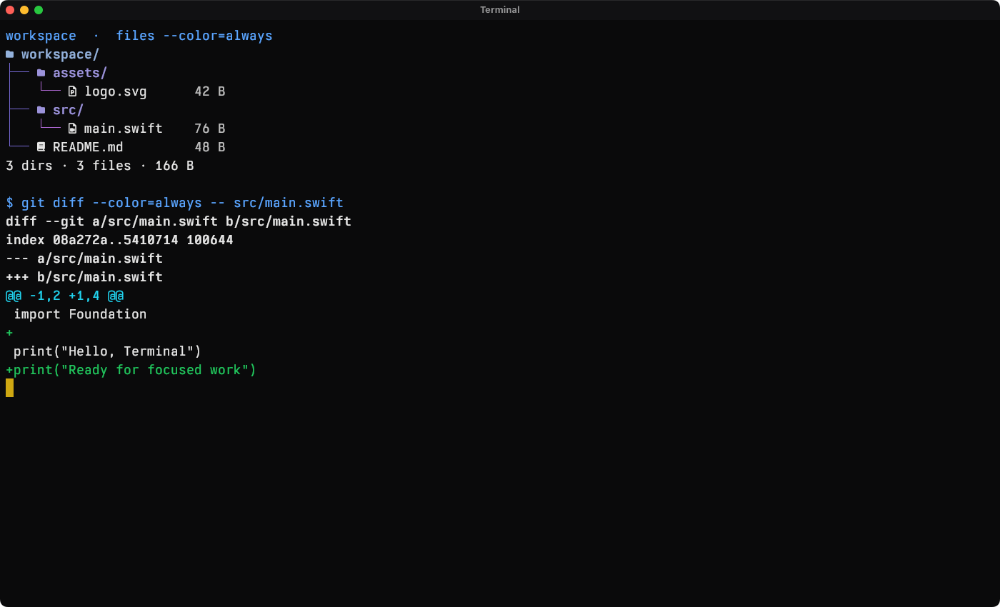
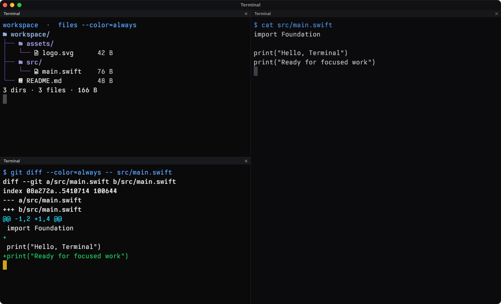
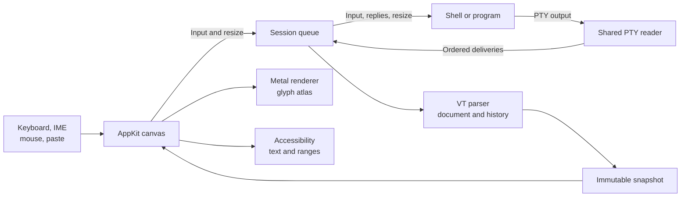

# Terminal

[](https://github.com/HelgeSverre/terminal/actions/workflows/ci.yml)


[](https://terminal2shell.com/)

<sub>*Mitigation: close the window. Reopening reintroduces the vulnerability.</sub>

A macOS terminal with Swift emulation, AppKit windows, and Metal rendering.
Split panes, run terminal applications, and display Kitty graphics in a minimal
window with bundled Obel Mono. Requires Apple Silicon and macOS 15 or later.



## Install

```shell
brew install --cask helgesverre/tap/helge-terminal
open -a "Helge Terminal"
```

Homebrew installs the published release to `/Applications/Helge Terminal.app` by default.
The package is listed on [tap.helgesver.re](https://tap.helgesver.re/).

## Build from source

Install Xcode with its Metal compiler and [just](https://github.com/casey/just),
then build and open a development instance:

```shell
just dev
```

To install your local build:

```shell
just install  # Build an optimized app in ~/Applications/Helge Terminal.app
just open
```

Quit the installed app before replacing it. `just reinstall` builds and replaces
it; `just uninstall` removes the app and preserves preferences.

Terminal is under active development. [Implementation status](docs/status.md)
tracks the remaining work and known limits.

## Everyday use

New panes inherit the active shell's working directory. Settings can set a
starting folder for new windows, font size, scrollback, and a few input
preferences. Obel Mono's regular, bold, and italic faces are bundled; Symbols
Nerd Font Mono fills missing icon glyphs.

| Action | Shortcut |
| --- | --- |
| New window / tab | ⌘N / ⌘T |
| Select tab 1–8 / last tab | ⌘1–8 / ⌘9 |
| Previous / next tab (wraps) | ⌥⌘← / ⌥⌘→ |
| Split right / below | ⌘D / ⇧⌘D |
| Close pane | ⌘W |
| Clear screen and scrollback | ⌘K |
| Find in scrollback | ⌘F |
| Next / previous match | Return / ⇧Return, or ⌘G / ⇧⌘G |
| Close the find bar | Esc |
| Increase / decrease font size | ⌘+ / ⌘− |
| Move to the start / end of the shell line | ⌘← / ⌘→ |

With the configured zsh bindings, ⌘→ also accepts an autosuggestion at the end of
the line. Hold Cmd over a URL to underline it, then Cmd-click to open it. Scroll
back to read earlier output; typing returns to the live screen.

The terminal handles Unicode text, true color, mouse reporting, OSC 8 links,
OSC 52 clipboard requests, and Kitty images. Accessibility exposes pane text,
ranges, selections, and links. AppleScript can send text, manage panes, read the
screen, and update settings.

See [usage and shortcuts](docs/usage.md) and [automation](docs/automation.md) for
behavior, commands, and limits.

## Panes



These are captures of the app rendering public sample files. Capture commands
and fixtures are documented with the [screenshots](assets/screenshots/README.md).

## Architecture

Each pane owns a session and a Metal layer. A serial session queue orders PTY
input, output, resizing, and terminal mutations. Immutable snapshots carry the
result to the AppKit view.



| Owner | Responsibility |
| --- | --- |
| [Window and pane tree](Sources/Terminal/main.swift) | Windows, tabs, splits, focus, and minimum sizes |
| [Pane presentation](Sources/Terminal/PanePresentation.swift) | Pane headers, colors, and inactive dimming |
| [Pane color palette](Sources/Terminal/PaneColorPalette.swift) | Swatch grid and hex entry shared by the pane popover and Settings |
| [Canvas](Sources/Terminal/Canvas.swift) | Native input, selection, geometry, and accessibility |
| [Session](Sources/Terminal/Session.swift) | Child process, PTY transport, ordering, and snapshot publication |
| [Emulation](Sources/Terminal/Emulation) | VT parsing, screens, history, reflow, and graphics state |
| [Rendering](Sources/Terminal/Renderer.swift) | Drawable scheduling, glyph residency, and Metal commands |

Panes share the renderer service and glyph budget. CoreText rasterizes glyphs;
Metal draws cells and images. A small C launcher handles process setup. Design
rationale is recorded in [decisions](docs/decisions.md). The [runtime
guide](docs/architecture.md) explains ownership and resize ordering; the
[glossary](GLOSSARY.md) defines project terms.

## Development

`just build` produces an incremental development bundle at `dist/Terminal.app`.
`just release-build` uses whole-module optimization. Neither command launches
the app.

| Command | Purpose |
| --- | --- |
| `just test` | Headless emulation, PTY, session, and workflow tests |
| `just check` | Tests plus local native UI and pane layout smoke checks |
| `just tui-stress files` | Real Files output while splitting and resizing |
| `just tui-stress codex` | Real Codex UI with a fixed local streaming provider |
| `just glyph-smoke` | Nerd Font glyphs through the PTY, rasterizer, and Metal |
| `just lint` / `just fmt` | Check source syntax / format handwritten Swift |
| `just debug` / `just logs` | Launch LLDB / stream native logs |
| `just release` | Sign, notarize, and package the app and installer |

The integration tests also need fish, Neovim, tmux, and fzf:

```shell
brew install just fish neovim tmux fzf
just test
```

GUI diagnostics open disposable windows and clean up their child processes.
The real-workload stress commands need Accessibility, Screen Recording, and
brief exclusive keyboard/mouse access. [Recorded results](reports/real-tui-pane-stress/README.md)
state what those checks verify. Hosted CI uses the headless suite and the
[documented virtual-GPU policy](docs/status.md).

Run `just` for the full command list. Packaging requires Developer ID identities
and notarization credentials; see [release setup and recovery](docs/releasing.md).
The bundle identifier is `no.helgesverre.terminal`.

## Documentation

| Guide | Contents |
| --- | --- |
| [Usage](docs/usage.md) | Shell editing, selection, settings, and shortcuts |
| [Automation](docs/automation.md) | Accessibility and AppleScript commands |
| [Architecture](docs/architecture.md) | Runtime ownership, presentation, and resize flow |
| [Specification](docs/spec.md) · [status](docs/status.md) | Requirements, completed work, and open gaps |
| [Benchmarks](docs/benchmarking.md) | Ghostty/Kitty comparisons, SQL output, resize stress, and measurement limits |
| [Swift cutover](docs/swift-cutover.md) | Paired Rust/Swift measurements and the archived Rust snapshot |
| [Terminal compatibility](docs/terminfo.md) | Bundled capabilities and parser coverage |
| [Clipboard protocol](docs/osc52-clipboard.md) | OSC 52 behavior and policy |
| [Fonts](assets/fonts/README.md) | Font sources and licenses |
