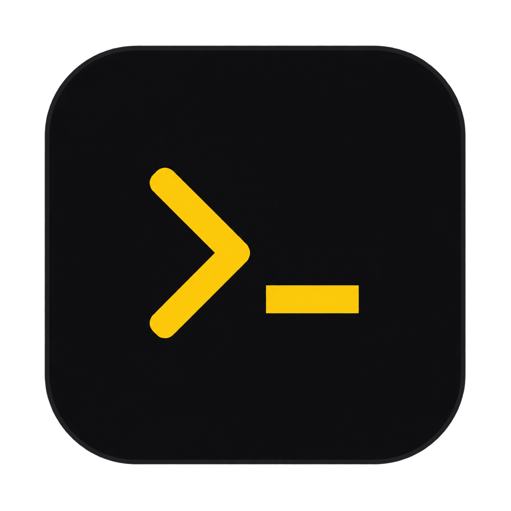
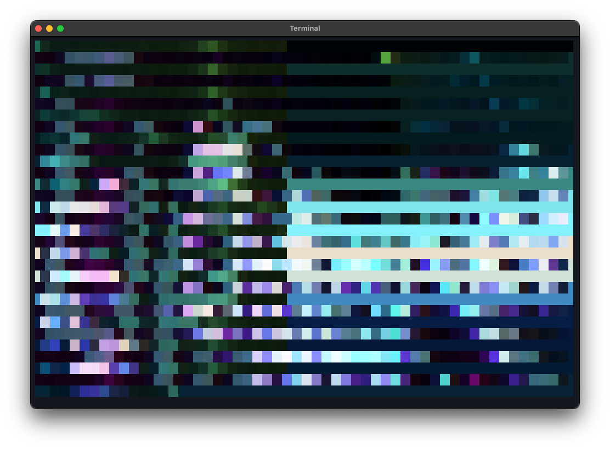
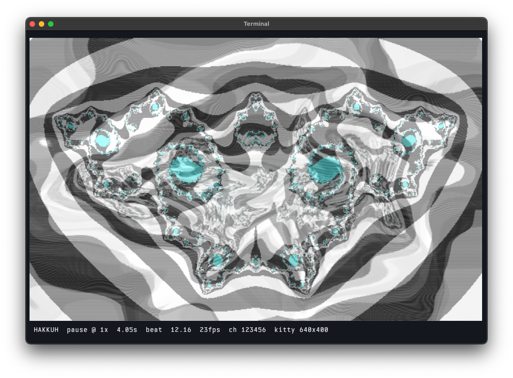
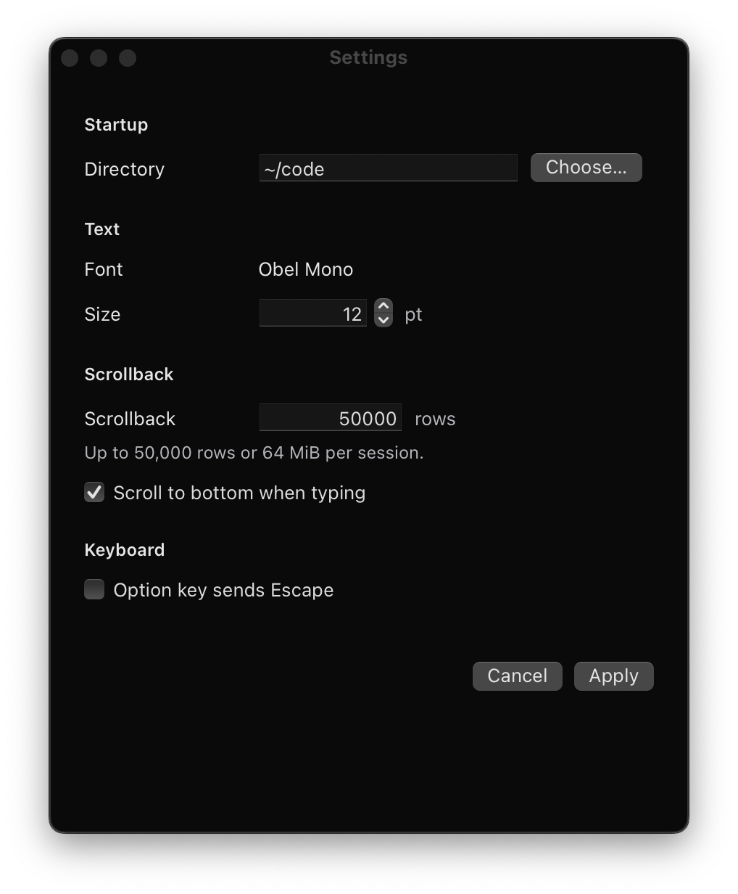
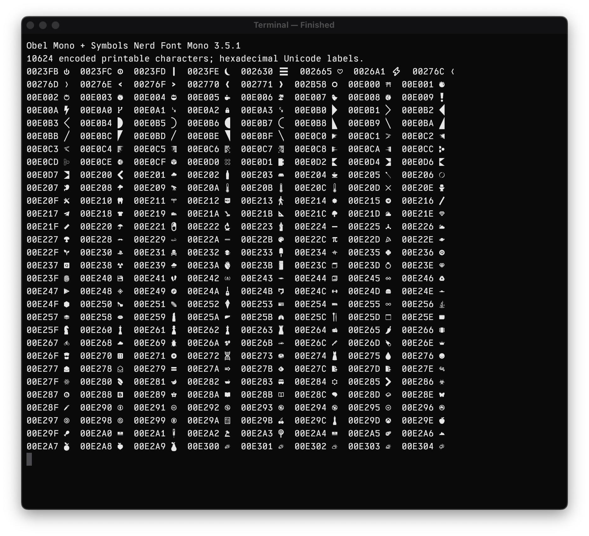

# Terminal

[](https://github.com/HelgeSverre/terminal/actions/workflows/ci.yml)


A native Apple Silicon terminal for macOS 15 or later. The terminal state and VT
parser are written in Swift; AppKit owns windows and native text input, and Metal
draws terminal cells through a CoreText glyph atlas. The default font is Obel
Mono, bundled with regular/bold/italic faces under the SIL Open Font License.
Bundled Symbols Nerd Font Mono supplies missing icon glyphs without changing
Obel's text metrics. Font licenses and sources are in [assets/fonts](assets/fonts/README.md).
This is an implementation in
progress, not a completed v1 release.

## Gallery

Actual application captures, including ASCII and Kitty image output. Screenshots
show rendering behavior; they do not establish performance.

| ASCII animation | Kitty graphics |
| --- | --- |
|  |  |





## Build and run

Requires Xcode (including the Metal compiler) and `just`. Build, test, Unicode
data generation and distribution require no Rust toolchain or Cargo cache.

```sh
just dev
```

Run `just` to list the available workflows. The development bundle is
`dist/Terminal.app`. `just build` uses incremental compilation; `just release-build`
uses whole-module optimization, as do install/package/release. Both build without
launching. `just verify` checks
the bundle and signature; `just debug` and `just logs` support diagnosis.
The project Run action uses `just dev`. Development bundles are ad-hoc signed;
Developer ID signing and notarization use the release workflow below.
No Vulkan SDK or runtime is needed.

```sh
just install     # Build and copy to ~/Applications/Helge Terminal.app
just open        # Open the installed copy
just reinstall   # Build and replace the installed copy
just uninstall   # Remove the installed app, preserving preferences
```

Installation is independent of the development bundle. Replacing or removing a
running installed app requires closing it first, so its shells are preserved.
A failed build keeps the installed copy. Only this app's bundle identifier is
eligible for replacement or removal.
When a matching notarized build exists, installation uses it automatically;
otherwise it installs the locally built optimized bundle.
Programs honor an inherited `NO_COLOR` setting. When opening from an automation
shell that sets it implicitly, use `env -u NO_COLOR just open` for normal colors.

## Packaging

The bundle identifier is `no.helgesverre.terminal`.

```sh
just release-status  # Check Developer ID certificates and notarization access
just package         # Signed app, ZIP and PKG under dist/release
just release         # Also notarize, staple and validate the app and PKG
```

Distribution uses existing Keychain identities and a Keychain notarization
profile. Set `APPLE_NOTARY_PROFILE`, or put `notaryProfile` in
`~/.config/terminal/release.json`. Application and installer identities are
detected when each has one valid Developer ID certificate; the same local file
can specify `applicationIdentity` and `installerIdentity` when needed.
Credentials and private keys are kept outside this repository. The PKG installs
to Applications; `just install` uses your personal Applications folder.

Shortcuts: ⌘N window, ⌘T tab, ⌘D split right, ⇧⌘D split below, ⌘W close pane,
⌘C copy selection, ⌘V paste, ⌘A select visible output, ⌘F literal history search,
⌘+/⌘− font size. ⌘←/⌘→ move to the start/end of the shell line; ⌘→ accepts
zsh autosuggestions configured on end-of-line. ⌥←/⌥→ move by word, and ⌘Backspace
clears the input line. Shift overrides application mouse tracking for local selection.
⌘K clears primary-screen scrollback and redraws a marked shell prompt; it leaves
alternate-screen applications alone. Normal interactive zsh launches install
prompt hooks from the app bundle while preserving your own startup files.
Scroll locally to inspect history; incoming output keeps the reading position,
and typing returns to the live screen. Alternate-screen programs retain the
primary scroll position for return. Cmd-click
an OSC 8 link to open an http/https/mailto URL. File drops paste quoted paths.

The current shell is `$SHELL`, falling back to `/bin/zsh`, with its normal login
configuration. Set the starting folder in Settings → Startup → Directory; `~`
and an empty field use your home folder. The setting applies to new shells;
existing sessions keep their current directory. Splits inherit the active pane's
reported local working directory; the bundled zsh integration reports it at each
prompt. Shells without directory reporting use the configured starting folder.
If the saved folder disappears,
new shells fall back to home. `just dev --working-directory /tmp` overrides it
for that launch. The font-size number field supports Up/Down and native stepper
buttons, bounded to 8–40 pt. Closing the last window quits the application and
shuts down its terminal sessions. `TERM=xterm-256color` remains an explicit
bring-up compatibility fallback. OSC 52 clipboard reads are denied; writes require native permission and are bounded.

## Verify

The native integration corpus also needs fish, Neovim, tmux and fzf:
`brew install just fish neovim tmux fzf`. GitHub CI installs these and runs the
Swift syntax/source-graph checks, native build, PTY/session/bridge tests and bundle
verification. `just fmt` formats hand-written Swift only; generated Unicode tables
are excluded. `just lint` checks graph completeness and Swift/Ruby syntax without
requiring a repository-wide formatting migration. Hosted Apple Paravirtual driver
failures have a narrow recorded GPU skip; CPU glyph tests still run, and local
real-GPU validation remains required.

```sh
just test
just smoke
just editing-smoke # Fresh-prompt cd/Backspace, autosuggestions and ZLE buffer
just glyph-smoke   # Every Nerd Font glyph through all four styles and Metal
just glyphs        # Print the full labeled glyph catalog for inspection
just close-smoke   # Last-window close and Cmd+Q; app and PTY child must exit
just idle
just terminfo-test # Bundled capabilities and parser behavior, including ACS
just check       # Tests plus the real native smoke
```

The native smoke starts its own shell, sends test commands through the text input
client, checks text/SGR/IME callback state/resize/split/Metal submission, writes a
JSON report, and quits that test instance. It does not synthesize global input.
It does not replace testing with real input methods or VoiceOver.

Headless replay accepts arbitrary byte streams on stdin and outputs a semantic
JSON snapshot, with replies on stderr:

```sh
printf '\033[31mhello\033[0m\r\n' | just replay 80 24
```

The last Rust implementation is preserved on
[`archive/rust-2026-11-08`](https://github.com/HelgeSverre/terminal/tree/archive/rust-2026-11-08)
at `91908204c4f8b56b795b4fc51da74813cd9125a7`, also tagged
`rust-before-swift-9190820`. Historical comparisons can consume
explicit frozen binaries; the active repository contains no Rust implementation.
Pinned Unicode data, licenses and reproduction commands live in
[tools/unicode](tools/unicode/README.md).

The Swift cutover reached 86.9–92.2% of Rust throughput across the four standard
visible-app workloads. The full SQL stress case reached 67.9%; that gap remains
open. See the [cutover measurements and validation](docs/swift-cutover.md) for
the paired results, build sizes and distribution evidence.

The native sources share one Swift compiler module. `native/Emulation` owns
VT interpretation, document/history, input encoding, search, graphics protocol
state and immutable snapshots. `native/Text` owns streaming text processing and
the pinned grapheme, width and lowercase tables. AppKit, PTY scheduling and
Metal rendering remain in `native`; the source graph lists every app and test
input explicitly.

See [the original spec](docs/spec.md), [platform decisions](docs/decisions.md),
and [implementation status](docs/status.md). Reports contain actual local test
and benchmark results; acceptance targets are not represented as measurements.

Kitty direct graphics supports bounded RGB/RGBA/PNG uploads, zlib/chunking,
placement, layering, and common deletion actions. Native dmscene demos have been
exercised in both text and higher-resolution Kitty modes. See
[benchmarking](docs/benchmarking.md) for the Ghostty/Kitty comparison harness and
the real 8.16 GB SQL dump stress test.
