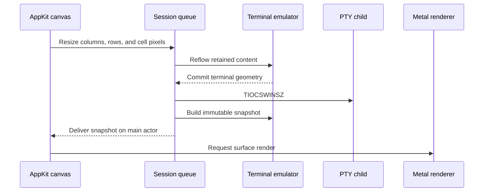

# Runtime architecture

Each pane owns a `Session`, a `TerminalCanvasView`, and a `CAMetalLayer`.
The application shares `TerminalRendering`, glyph residency, and its glyph
memory budget across panes. The [README diagram](../README.md#architecture)
shows the main input and display path.

## State and presentation

The session's serial queue owns the child PTY and orders input, output,
resizing, and emulator mutations. `TerminalEmulator` interprets VT sequences;
`TerminalDocument` owns retained text, history, and reflow. Immutable
`TerminalSnapshot` values cross into the AppKit view.

The canvas handles keyboard, IME, paste, mouse input, and selection. It derives
its accessibility projection from the delivered snapshot and requests rendering
for its pane surface. Accessibility exposes text and ranges through a bounded,
read-only projection; AppleScript sends committed text through the normal
session-input path. The [automation guide](automation.md) describes those
interfaces.

## Resizing



The canvas derives cell dimensions from its AppKit bounds and backing scale.
The session serializes reflow with PTY I/O. After the emulator commits the new
geometry, it updates the child's PTY window size and publishes a snapshot.

`TerminalWindow` owns the separate pane layout. On split, close, and window
resize it recursively allocates each subtree's minimum size. A new nested
split gets ancestor space before its divider is positioned. This keeps AppKit
layout decisions out of terminal-state callers. The [pane stress
regressions](../reports/real-tui-pane-stress/README.md) record the failures that
led to these rules.

## Source map

| Area | Entry point |
| --- | --- |
| Windows, pane tree, menus | [main.swift](../Sources/Terminal/main.swift) |
| Native input and accessibility | [Canvas.swift](../Sources/Terminal/Canvas.swift) |
| PTY and terminal-state ordering | [Session.swift](../Sources/Terminal/Session.swift) |
| Emulation and document storage | [Emulation](../Sources/Terminal/Emulation) |
| Unicode decoding and text tables | [Text](../Sources/Terminal/Text) |
| Rendering and glyph resources | [Renderer.swift](../Sources/Terminal/Renderer.swift) |
| Process setup | [Spawn.c](../Sources/Terminal/Interop/Spawn.c) · [Launcher.c](../Sources/TerminalLauncher/Launcher.c) |

`Sources/Terminal` contains the application in one Swift compiler module.
`Tests/TerminalTests` holds directly compiled test programs, `Resources/Terminal`
holds bundle inputs, and `Benchmarks/TerminalBench` holds the PTY driver.
The small `Sources/TerminalLauncher` C executable sets up shell launches.
`justfile` assembles the bundle; the source manifest lists canonical repository
paths and verifies that every Swift source belongs to its declared group.
[Decisions](decisions.md) records the
tradeoffs, and the [glossary](../GLOSSARY.md) defines project terms.

## Inspect terminal state

Replay a byte stream without opening a window:

```shell
printf '\033[31mhello\033[0m\r\n' | just replay 80 24
```

The command prints a semantic JSON snapshot; terminal replies go to stderr.
Pinned Unicode data and reproduction commands are documented in
[tools/unicode](../tools/unicode/README.md).
