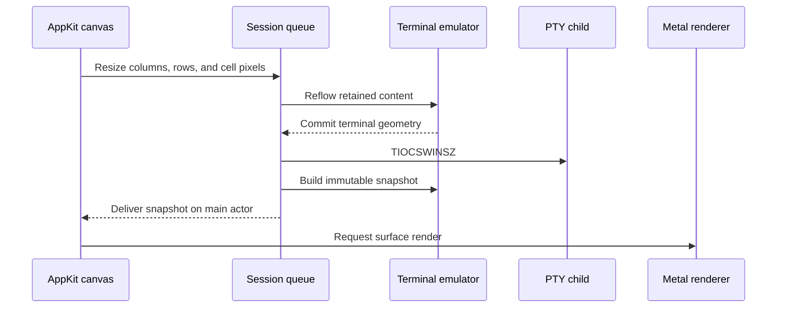

# Runtime architecture

Each pane owns a `Session`, a `TerminalCanvasView`, and a `CAMetalLayer`.
The application shares `TerminalRendering`, glyph residency, and its glyph
memory budget across panes. The [README diagram](../README.md#architecture)
shows the main input and display path.

## State and presentation

The session's serial queue orders input, output, resizing, and emulator
mutations. A shared serial I/O lane reads each child's nonblocking PTY while
the owner parses earlier output. `PTYReadBroker` orders read deliveries and
owner submissions; terminal state stays on the session queue.
`TerminalEmulator` interprets VT sequences;
`TerminalDocument` owns retained text, history, and reflow. Immutable
`TerminalSnapshot` values cross into the AppKit view.

Printable ASCII goes from the feed buffer straight into row cells, and a
complete `ESC [ … m` is parsed in place; everything else takes the streaming
parser. Decoded text is printed as runs of fresh clusters: single scalars, and
whole multi-scalar clusters when all their scalars are in the buffer. A cluster
that arrives in pieces extends its lead cell instead. A row cell is eight
bytes: a scalar, an index into the row's own style table, and flags. Text of
more than one scalar and hyperlinks live beside the row in a sparse array
ordered by column, and a cell flag records whether a cell has an entry there.

The canvas handles keyboard, IME, paste, mouse input, and selection. It derives
its accessibility projection from the delivered snapshot and requests rendering
for its pane surface. Accessibility exposes text and ranges through a bounded,
read-only projection; AppleScript sends committed text through the normal
session-input path. The [automation guide](automation.md) describes those
interfaces.

## PTY transport

The kernel returns at most about a kilobyte per PTY read. The read endpoint
gathers consecutive reads into one slab, so the owner is woken once per slab
rather than once per kilobyte. It waits up to 10 µs for the child to refill the
queue, but only after a read that emptied a full queue; a shorter read is
delivered at once. The read runs outside the broker's admission lock; a separate read
lock makes close wait for the read in flight. A control submission seals the
preceding output batch. The broker
holds byte credit until the parser consumes those bytes, and node credit until
all resumable work for that record finishes. The owner queue keeps one immutable
record per delivery, including a fully consumed record with pending REP work.

Read-ahead is limited to 64 KiB and 256 output nodes. Each batch is at most
16 KiB; a partially consumed head can retain its consumed prefix. These are
payload bounds, not exact allocator or process-memory measurements. Semantic
controls retain their existing admission rules. A larger 2 MiB prototype
improved throughput but delayed input under continuous output; the
[comparison](../reports/shared-pty-reader-649/README.md) records both variants.

`PTYReadEndpoint` owns readiness, pause/resume, and cancellation on the shared
lane. `PTYDescriptorLifetime` leases the descriptor for reads, writes, and
resize ioctls. Physical close waits for active operations and both source
cancellations, preventing a late operation from using a reused descriptor.
Writes, reflow, snapshots, and process reaping stay with the session owner.

## Resizing



The canvas derives cell dimensions from its AppKit bounds and backing scale.
The session serializes reflow with PTY I/O. After the emulator commits the new
geometry, it updates the child's PTY window size and publishes a snapshot.

`TerminalWindow` owns the separate pane layout. On split, close, and window
resize it recursively allocates each subtree's minimum size. A new nested
split gets ancestor space before its divider is positioned. This keeps AppKit
layout decisions out of terminal-state callers. The [pane stress
regressions](../reports/real-tui-pane-stress/README.md) record the failures that
led to these rules.

## Source map

| Area | Entry point |
| --- | --- |
| Windows, pane tree, menus | [main.swift](../Sources/Terminal/main.swift) |
| Native input and accessibility | [Canvas.swift](../Sources/Terminal/Canvas.swift) |
| PTY and terminal-state ordering | [Session.swift](../Sources/Terminal/Session.swift) |
| Read admission, readiness, and descriptor lifetime | [IO](../Sources/Terminal/IO) |
| Emulation and document storage | [Emulation](../Sources/Terminal/Emulation) |
| Unicode decoding and text tables | [Text](../Sources/Terminal/Text) |
| Rendering and glyph resources | [Renderer.swift](../Sources/Terminal/Renderer.swift) |
| Process setup | [Spawn.c](../Sources/Terminal/Interop/Spawn.c) · [Launcher.c](../Sources/TerminalLauncher/Launcher.c) |

`Sources/Terminal` contains the application in one Swift compiler module.
`Tests/TerminalTests` holds the Swift Testing suites that `Package.swift`
builds, `Tests/Programs` the few directly compiled probe and PTY programs, `Resources/Terminal`
holds bundle inputs, and `Benchmarks/TerminalBench` holds the PTY driver.
The small `Sources/TerminalLauncher` C executable sets up shell launches.
`justfile` assembles the bundle; the source manifest lists canonical repository
paths and verifies that every Swift source belongs to its declared group.
[Decisions](decisions.md) records the
tradeoffs, and the [glossary](../GLOSSARY.md) defines project terms.

## Inspect terminal state

Replay a byte stream without opening a window:

```shell
printf '\033[31mhello\033[0m\r\n' | just replay 80 24
```

The command prints a semantic JSON snapshot; terminal replies go to stderr.
Pinned Unicode data and reproduction commands are documented in
[tools/unicode](../tools/unicode/README.md).
