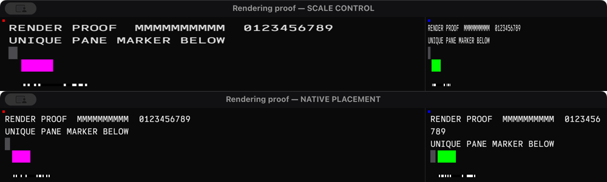
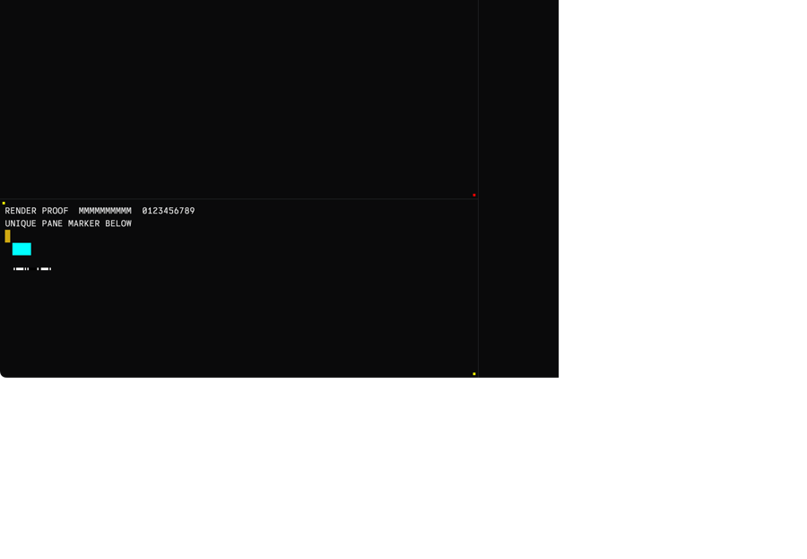

# Pane-specific rendering verification follow-up

This follow-up strengthens the earlier screenshot test. It checks all three panes, absolute marker dimensions, and content position relative to native AppKit references within each captured frame. Native mouse tracking and final drawable progress are verified separately. No production renderer changes or app installation were made for this follow-up.

## Result and limits

| Same executable, different placement flag | Complete frames | All three panes correct | Failed frames | Inconclusive complete frames |
| --- | ---: | ---: | ---: | ---: |
| Scaling control | 603 | 486 | 113 | 4 |
| Current native placement, completed retry | 660 | 658 | 0 | 2 |

Every measurable candidate marker had exactly zero error in x, y, width and height, not merely a square aspect ratio or a value inside the oracle's one-pixel tolerance. Each pane has its own color and its own native reference markers. The two inconclusive frames are not passes. The candidate also emitted 579 idle samples and had 12 intersample intervals over 25 ms. Requested 60 Hz capture is not a guarantee that every physical display frame was inspected.

The first candidate attempt is retained as **incomplete**: ScreenCaptureKit reported that the system stopped the stream before the native mouse phase. Its 377 correct complete frames cannot establish native-drag coverage or final-frame convergence. The completed retry had no capture errors.

The control also retained stream-stop errors, but only after the recorded native phases and final-generation gate. Its divider input ended at host time 280808.443496 and window input at 280811.077553; sample 749 captured the final gate at presentation timestamp 280811.111675. The two error records follow sample 811, whose timestamp is 280812.498124. The control therefore supports the reported phases and final gate, but not uninterrupted capture through the intended recording duration. The errors have no individual timestamp; these numbers establish persisted-record order, not an exact error-onset time. Both error messages remain in the manifest and raw log.

The comparison shows control sample 64 and candidate sample 153 at the same pane geometry. The control's intended 60×40 marker became 105×40 in the left panes and 30×40 in the right pane. Each image is cropped to the top 300 pixels and uniformly reduced by half; text and marker distortion are present in the original capture.

## What the oracle measures

Each pane renders one uniquely colored 60×40 Metal rectangle at local pixel coordinate (40,140). Two 8×8 native AppKit reference views locate its top-left and bottom-right bounds in the same captured frame. The oracle requires all three pane IDs, checks rectangle width and height independently, and checks its offset from the corresponding native reference. A missing visible marker fails; missing or clipped references and capture scaling are inconclusive.

The oracle is self-tested against uniform 2× scaling, missing Metal content, shifted content, clipped references, capture scaling, an empty frame, duplicate references, and an unrelated same-colored component outside the pane. All failure/inconclusive complete frames preserve PNGs independently of aspect ratio, and the complete window video and all stream statuses/timestamps are retained.

Independent review caught one false positive in the control: a green titlebar component outside the pane was counted as another green Metal marker. The corrected oracle limits content-color components to their native pane bounds. Replaying the preserved raw component records changes the control count from 114 to 113 failures. Original samples and classifications remain available; this correction does not change candidate classifications. The native window control had no failure beyond the one-pixel tolerance after this correction, while the native divider control had three.

## Actual native tracking and final progress

The first directed `CGEvent.postToPid` experiment did not enter AppKit tracking and is excluded from native-input evidence. The final runs used HID mouse down/drag/up events only when the exact probe PID was frontmost, at points exported by its own window. No installed user window was manipulated. AppKit logged native divider tracking begin/end with 348 geometry updates, and native window live-resize callbacks with 318 geometry updates during the window-drag interval.

During these verified native intervals, the completed candidate supplied 130 correct complete frames for the divider drag and 121 for the window drag. Both intervals therefore have actual captured pixels as well as event delivery evidence; neither is inferred from injection success.

After tracking, a final deterministic resize ends with static terminal content. Each render carries a pane ID and geometry generation. `MTLDrawable.addPresentedHandler` records the actual presentation timestamp; a 32-bit visible barcode encodes the generation with sentinels and a pane-dependent checksum. Decoding is allowed only when the marker is correctly sized/positioned and the whole barcode fits the native pane bounds. [Apple: drawable presentation handler](https://developer.apple.com/documentation/metal/mtldrawable/addpresentedhandler(_:))

For all three panes, expected generations 640, 529 and 629 received nonzero actual presentation timestamps and appeared as valid barcodes in a later correct captured frame. Candidate sample 764 satisfied the gate approximately 14 ms after the final resize began. This demonstrates final-geometry progress in this fixture; it does not prove that every hypothetical drawable-pool race is impossible.

## The two inconclusive candidate frames

Sample 331 retained the old 900-point capture width while the app had laid out a 1100-point window. The new right reference at pixel x=2184 lies beyond the old 1800-pixel capture width.

Sample 388 lacks the titlebar and upper content, including native references. Its capture metadata still describes 900×608 points, while the app had laid out 1100×788 points about 14 ms earlier. The lower pane's reference/content coordinates are exactly 360 pixels above those in the following normal frame, matching twice the 180-point height difference. The next captured frame, approximately 18.47 ms later, has the new metadata and normal content.

This supports a capture-geometry lag explanation affecting the entire window, rather than isolated terminal content disappearing. It remains inconclusive about the physical display because no simultaneous display-wide capture was taken. These frames must not be described as visually correct.

## Provenance and review

The isolated diagnostic source is commit `53bb3b9`, based on `b4f95b0`. It is a probe commit and must not be cherry-picked into production. The two primary runs used the same app executable SHA-256 `00d34275e516b1ccd81fcb05f8cddbfaee5882ee6ff2e38d14fc0fd171334fd0`; only the placement flag changed. The control PID/window were 87902/22183; the completed candidate PID/window were 89620/22208. The interrupted candidate was 88464/22195. All owned apps, capture helpers and PTY children exited. Installed user app PID 29327 was preserved.

ScreenCaptureKit filtered only the owned probe window, with audio and microphone disabled. Other agents ran headless builds/tests during some captures; this was not a quiet performance benchmark. The native fixture, generated mouse sequence, capture configuration, color thresholds and layout were otherwise shared across variants.

[The compact manifest](../reports/renderer-proof-evidence.json) includes run analyses, source/base IDs, executable and helper hashes, final-generation gates, per-pane classifications, native-phase checks and capture errors. Its per-run hashes cover the final `analysis.json` files and, for both primary runs, the `frames-reviewed.jsonl` records used for the displayed classifications. Full videos, PNGs, original/reviewed frame records, app presentation traces and the executed app/helper binaries are retained at `/Users/helge/.codex/artifacts/terminal-rendering-proof-v2/`.

Astra independently reviewed the native-reference coordinate mapping, pane assignment, barcode validation, final progress gate, ROI correction and inconclusive-frame geometry. This follow-up supports keeping the native placement correction without a speculative transaction-presentation rewrite. [Apple: NSView layer content placement](https://developer.apple.com/documentation/appkit/nsview/layercontentsplacement-swift.property)
