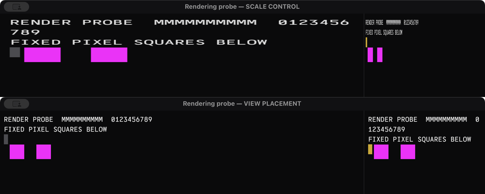

# Independent review of transient split/resize stretching

Reviewed 2026-11-08 against `eb0293e2831ffdb504bfbbef733da48dacaefbe6`, then tested the actual app in an isolated compositor-capture probe. The recommended placement correction is commit `4b9e64c`, integrated as `c7d52b6`. It uses AppKit's view placement policy to preserve both the size and top anchor of retained Metal content.

## Captured result

ScreenCaptureKit captured only the separately named probe window, with audio and microphone disabled. Three runs of the same binary changed only the placement flag. All used static text, two 60×60 pixel magenta markers per pane, vertical splits, nested horizontal splits, repeated divider changes, and 100 whole-window size changes. No artificial rendering delay was introduced.

| Variant | Complete captured frames | Frames with distorted markers | Frames missing the original top-left marker |
| --- | ---: | ---: | ---: |
| Scaling control, guard retained | 536 | 61 | 57 |
| Existing fix: direct layer `.topLeft` | 542 | 0 | 38 |
| Candidate: view placement `.topLeft` | 536 | 0 | 0 |

The control visibly stretched text and turned 60×60 squares into rectangles, including 148×60 and 22×60. The existing fix prevented aspect distortion in these runs but misplaced retained content vertically; one inspected frame moved the top marker from y=196 to y=616, leaving a blank region. The candidate retained 60×60 squares and the original top marker in every complete captured frame. Capture metadata reported content scale 1 throughout; the capture did not create these aspect changes.



The screenshot comparison uses the same final divider location, with synthetic content only. It juxtaposes control frame 27 and candidate frame 60, cropped to the first 400 image rows and reduced uniformly by half. These are representative frames from separate runs, not a claim of identical timing.

The primary evidence manifest is [renderer-placement-evidence.json](../reports/renderer-placement-evidence.json). Full window-only videos, per-frame marker measurements, geometry traces, PNGs, and hashes are retained outside the repository at `/Users/helge/.codex/artifacts/terminal-rendering-review/`. The diagnostic source is commit `c9cf06e`; all three primary runs used executable SHA-256 `2863e151216e28c258a68925412d9cfe1596e9b3d2e9a99878ca3894d75b6f82`. Their owned PIDs were 63952, 64422, and 65078. All probe apps and PTY children exited; installed user app PID 29327 remained untouched.

This is evidence for the controlled split/window sequence at the requested 60 Hz capture cadence, not proof about every physical display scanout or every user workflow. Continuous mouse tracking, mixed-DPI monitor movement, and arbitrary shell redraws remain outside this experiment. A transaction-based renderer rewrite was not needed for the passing candidate and was not implemented.

## Astra follow-up review

An independent Astra review of production `b4f95b0` and diagnostic `c9cf06e` on 2026-11-08 found that the existing capture detector needs stronger assertions before it can settle reports of a remaining transient artifact. Keep the AppKit placement correction, but do not treat the passing sequence above as proof that the remaining report is resolved.

The subsequent [pane-specific follow-up](rendering-proof-followup.md) closes the identified detector, actual mouse-tracking and final-geometry progress gaps for its recorded fixture: 658 correct complete candidate frames, zero failures and two inconclusive frames, against 113 failures in the scaling control. It verifies actual presentation timestamps and captured geometry-generation barcodes. Capture gaps, the two inconclusive frames and mixed-DPI limitations remain explicit; no transaction-presentation rewrite was needed.

- The detector at `tools/RenderingCapture.swift:53–54` only flags rectangles whose width and height differ by more than two pixels. Uniform scaling, missing markers, and a missing pane can pass that predicate. PNG preservation uses the same predicate. Rechecking the archived candidate rectangle data found all **2,814 detected markers exactly 60×60 pixels**, so uniform scaling was absent from those observations; the boolean alone could not establish that.
- Identical magenta markers do not identify individual panes. Each pane needs distinct fiducials, checks of absolute width and height, and a position relative to its current viewport. Missing or clipped observations must be classified separately from a pass.
- The capture contains 536 complete frames and 91 successive timestamp intervals longer than 25 ms. Idle suppression may explain some intervals; these are not evidence of dropped physical display frames. Only complete capture statuses were logged. The fixture used programmatic divider and window geometry changes, rather than live mouse tracking.
- The drawable-size guard compares request and drawable dimensions once. Main-thread layer geometry can change before presentation. That is a synchronization gap to measure, not a demonstrated cause of current stretching. GPU command completion and snapshot revision also cannot certify visibility or distinguish two viewport geometries rendered from the same snapshot.

The next diagnostic should use a separately identified current-build window, uniquely marked panes, live divider dragging, nested splits, and a live window resize. Record all capture statuses and timestamps, retain lossless neighbors of anomalous frames, and compare the same sequence with a scaling-placement negative control. Add diagnostic geometry generations, request/drawable identity, actual drawable presentation callbacks, and a rendered generation marker to correlate pixels with work. After mouse-up, verify that the final geometry appears with otherwise idle content. Mixed-DPI movement remains untested without a suitable second display.

Apple distinguishes GPU completion from presentation: `addPresentedHandler` observes presentation, and `presentedTime` is zero for an unpresented drawable. Use those signals alongside captured pixels; neither replaces them. The asynchronous presentation path is valid as written. Do not switch to transaction-coupled presentation until a captured transition establishes the need. [Apple: drawable presentation handler](https://developer.apple.com/documentation/metal/mtldrawable/addpresentedhandler(_:)), [Apple: presentedTime](https://developer.apple.com/documentation/metal/mtldrawable/presentedtime), [Apple: presentsWithTransaction](https://developer.apple.com/documentation/quartzcore/cametallayer/presentswithtransaction)

## Findings

The guard is useful stale-work filtering, but the existing smoke result is insufficient evidence for the reported visual defect. `RendererMetrics.recordPresentation` runs before `command.present(drawable)` and compares two captured sizes. It does not observe an actual presentation, the current layer geometry, a retained previous drawable, or an ancestor transform. The gravity assertion inspects one model-layer property before stress. Its name, `split_resize_retained_frame_does_not_scale`, promises more than it measures.

The actual drawable dimensions already supplied the vertex shader extent **before** `eb0293e`. `Terminal.metal` maps fixed pixel quads through that extent. Consequently, removing the new guard and observing mismatched request/drawable sizes proves that stale requests occur, but does not by itself prove glyph stretching. With constant backing scale and cell metrics, an old grid rendered into a differently sized drawable normally clips or exposes more cells at the same pixel size. Scaling the resulting image into different layer bounds is a separate operation.

There is a concrete configuration inconsistency: `TerminalCanvasView` is layer-backed through `makeBackingLayer()` and `wantsLayer`, but sets `layer.contentsGravity` directly while leaving `layerContentsPlacement` at its default. Apple identifies the view property as the cached-content placement policy and documents its default as independent scaling of both axes. Use the view API to express top-left placement. [Apple: layerContentsPlacement](https://developer.apple.com/documentation/appkit/nsview/layercontentsplacement-swift.property)

## Initial ranked causes and discriminating evidence

| Priority | Candidate | Evidence and falsifiable check |
| --- | --- | --- |
| 1 | Retained drawable or new drawable composited against different geometry | Closest match to “stretched briefly, then correct.” Metal presentation is asynchronous to Core Animation transactions by default. Record final compositor frames while logging geometry and actual drawable presentation times. A stationary glyph changing width/height while its raster metrics remain fixed implicates composition rather than terminal reflow. |
| 2 | AppKit placement/flip policy not expressed consistently | Direct gravity leaves the view placement at `scaleAxesIndependently` in a native probe. `.topLeft` on the view selects the backing-layer gravity for its coordinate convention. Test the native view policy through actual window attachment and split reparenting; inspect both policy and effective gravity rather than requiring a literal `topLeft` layer string. |
| 3 | Test build provenance | At review time `ps` showed only user PID 29327 at `/Users/helge/Applications/Helge Terminal.app/Contents/MacOS/Terminal`; its bundle is 0.1.1. Main `dist/Terminal.app` is 0.1.2. Separately reported resize diagnostics run an old baseline. A report of stretching in a test window is not yet evidence of stretching in `eb0293e`; attach PID, executable path, binary hash, commit, and window ID to the recording. |
| 4 | Intermediate split geometry or ancestor animation | `split()` gives both children the full split bounds before setting the divider and calling `adjustSubviews()`. This queues intermediate render work. Those mutations alone do not prove an intermediate frame reached the screen, since normal layer transactions batch changes. Trace ancestors' model/presentation bounds and transforms; record whether any full-size child drawable is displayed at half-size. |
| 5 | Geometry changes after drawable acquisition | The guard compares request and texture once. Geometry can change after that check and before display, including an old request obtaining an old drawable that matches it. A geometry generation would improve stale-work rejection, but cannot alone synchronize compositor state or fix retained-image scaling. |

Do not equate terminal line reflow, a shell redrawing its prompt, top/bottom anchoring jumps, and glyph aspect-ratio distortion. They have different causes and need different assertions.

## What Apple specifies

`CAMetalLayer.drawableSize` is a texture size in pixels. Its natural relationship is layer bounds multiplied by `contentsScale`; it is not a presentation synchronization primitive. The current code follows that relationship and uses actual texture dimensions in its shader. A local Metal probe also found fractional sizes truncated consistently with the code's integer conversion on this machine; it did not reproduce a fractional-size discrepancy. [Apple: drawableSize](https://developer.apple.com/documentation/quartzcore/cametallayer/drawablesize)

Positional gravity preserves content size; scaling gravity can distort it. Vertical gravity names depend on `contentsAreFlipped()`. A literal `.topLeft` is therefore not a universal top-left assertion. [Apple: contentsGravity](https://developer.apple.com/documentation/quartzcore/calayer/contentsgravity)

The windowless probe matching this view's overrides reported:

| Operation | View placement | Layer gravity | Contents flipped |
| --- | --- | --- | --- |
| Create backing layer | 0: independent scaling | `resize` | true |
| Set layer gravity directly | 0: independent scaling | `topLeft` | true |
| Set view placement to `.topLeft` | 11: top left | `bottomLeft` | true |

A simple resize preserved direct gravity; this review found **no proof that AppKit resets it on every resize**. Both the windowless and actual-window split probes temporarily changed the flipped state during reparenting. The captured result above establishes why raw gravity and offscreen assumptions are inadequate and verifies the native placement correction in actual windows.

Keep AppKit's backing-layer ownership. `makeBackingLayer()` is the supported customization hook. Replacing the layer with a hosted layer would transfer more lifecycle and scale responsibility to this app and is unnecessary for the first correction. [Apple: setting up layers](https://developer.apple.com/library/archive/documentation/Cocoa/Conceptual/CoreAnimation_guide/SettingUpLayerObjects/SettingUpLayerObjects.html)

For the existing `wantsUpdateLayer == true` design, explicitly choosing `.onSetNeedsDisplay` is consistent with the installed `NSView.h` guidance; geometry already calls `redraw()` directly. Do not change to `.never` casually, because the app uses `updateLayer()` as an additional refresh path. `.duringViewResize` requests redraws; it does not make an asynchronous render request complete before Core Animation commits. Keep redraw-policy changes out of the first placement A/B to isolate the variable. [Apple: redraw policy](https://developer.apple.com/documentation/appkit/nsview/layercontentsredrawpolicy-swift.property)

The current asynchronous `command.present(drawable)` path is valid with `presentsWithTransaction == false`. If evidence later requires transaction-coupled presentation, Apple requires a different sequence: commit the render command buffer, wait until scheduled, then call **`drawable.present()`** in the transaction intended to carry the geometry. Do not merely set the property to true while retaining `command.present`. A transaction begun on the rendering queue is not automatically the main thread's AppKit geometry transaction. [Apple: presentsWithTransaction](https://developer.apple.com/documentation/quartzcore/cametallayer/presentswithtransaction), [Apple: CATransaction](https://developer.apple.com/documentation/quartzcore/catransaction)

Disabling implicit actions for an explicit geometry transaction is appropriate only if unwanted animation is demonstrated. It does not couple asynchronous Metal presentation to that transaction. Do not add sleeps, a display loop, repeated flushes, or hidden-content intervals as a substitute for understanding the displayed transition.

## Minimal recommended patch

In `TerminalCanvasView.init`, after `wantsLayer = true`, set:

```swift
layerContentsPlacement = .topLeft
```

Remove the direct `layer.contentsGravity = .topLeft` assignment. Keep the drawable-size guard and actual-texture shader extent. Change the configuration assertion to check `layerContentsPlacement == .topLeft`; report the view placement, effective gravity and flipped state. The minimal patch does exactly this and renames the smoke key to `split_resize_layer_placement_configured`. The full capture probe additionally logs scale, redraw policy and layer identity.

This supported correction passed the recorded sequence and fixes a measured anchoring defect in the earlier fix. Earlier test-window provenance was ambiguous: the other resize agent confirmed its diagnostics were based on `968f1c8`, without the rendering fix, and had no compositor recordings. Do not attribute those observations to the updated renderer, or infer that installing an updated build has happened; the user's installed app was deliberately left alone.

## Verification method and follow-up coverage

1. Use only a separately named test app/window. Record executable path, PID, commit and binary hash at launch. Leave the user's installed window untouched. Run baseline, current fix, and the view-placement variant with identical content and resize steps.
2. Render a static diagnostic pattern: repeated glyphs, fixed pixel squares, and a distinct top-left marker. Include horizontal and vertical splits, divider drags, large window resize jumps, continuous live resize, nested splits, and reopening after occlusion. Keep shell output out of the pattern so prompt redraw cannot confound the result.
3. Record the final composited test window at display cadence. Inspect every changed frame, including the frame before the first new drawable. Measure square width/height and glyph advance against the stable reference. Cropping is acceptable during a transition; changed aspect ratio is a failure. Validate the capture with a deliberately scaled-placement negative control; a passing endpoint screenshot is insufficient.
4. Correlate captures with geometry generations and `MTLDrawable.addPresentedHandler`/`presentedTime`. Sample AppKit-owned model and presentation layer geometry on the main thread; do not read NSView state from the rendering queue. Include relevant ancestor transforms. The presentation layer is an approximation useful for diagnosis, not a substitute for the captured pixels. [Apple: drawable presentation handler](https://developer.apple.com/documentation/metal/mtldrawable/addpresentedhandler(_:)), [Apple: presentation layer](https://developer.apple.com/documentation/quartzcore/calayer/presentation())
5. If current code still visibly scales with correct placement, isolate synchronized presentation as the next variant using Apple's exact sequence. Separately verify progress after the final resize with an otherwise idle session: a stale-frame drop must not leave the latest content undisplayed indefinitely.

The exit criterion is a reproducible visible failure in the control and no distorted captured frames in the fix across the same sequence, plus eventual presentation of the final geometry. Zero submission mismatch counters alone cannot satisfy it.
