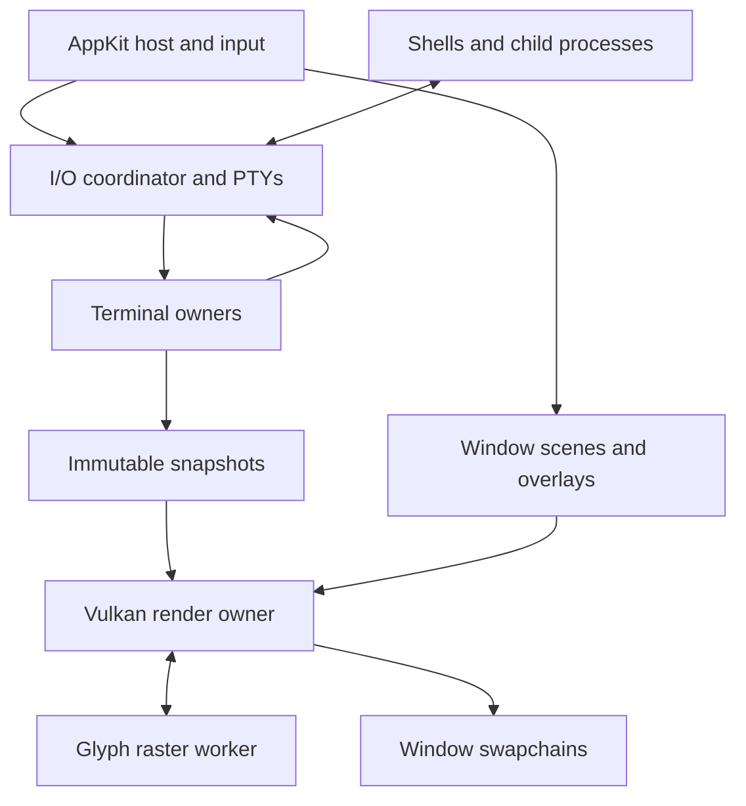
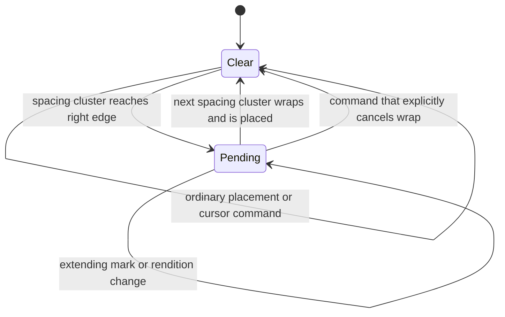
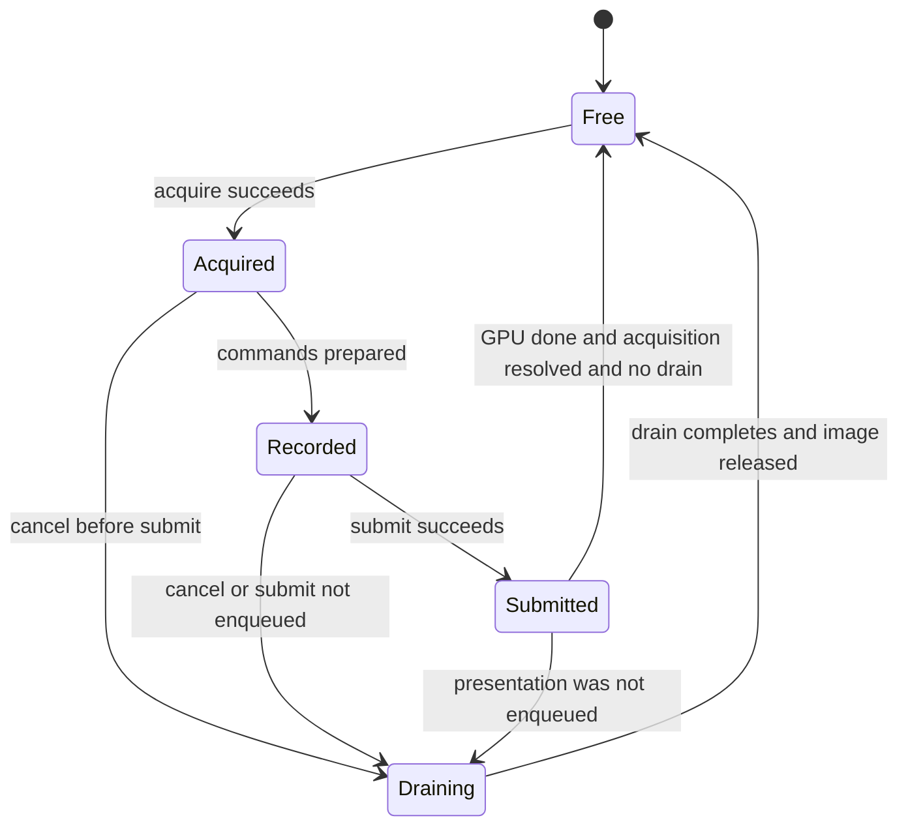

# macOS Vulkan Terminal — Data Model and State Machines

**Status:** implementation specification, version 1.0  
**Prepared:** 7 November 2026  
**Audience:** the coding agent implementing the application and the engineer reviewing it  
**Primary target:** Apple Silicon, macOS 26 or later  
**Implementation:** Rust terminal/runtime/rendering core; Swift AppKit host; Vulkan through a bundled Vulkan-on-Metal driver

## Contents

- [Decisions and implementation instructions](#0-instructions-to-the-implementing-agent)
- [Product scope](#1-product-and-compatibility-scope)
- [Ownership, threads, and queues](#2-architecture-and-ownership)
- [Entities and coordinate systems](#3-entity-model-and-coordinate-systems)
- [Terminal data model and storage invariants](#4-terminal-state-and-storage)
- [State-machine inventory](#5-state-machine-inventory)
- [Parser](#6-vt-parser-and-byte-decoding), [Unicode and wrapping](#7-graphemes-placement-and-deferred-wrap), [screens and modes](#8-screens-modes-and-terminal-commands)
- [History, selection, search, and resize](#9-history-anchors-selection-search-and-resize)
- [PTY/process lifecycle](#10-pty-process-and-session-lifecycle) and [native input/paste](#11-native-input-ime-mouse-and-paste)
- [Snapshots and synchronization](#12-snapshots-synchronized-output-and-damage)
- [Fonts and drawing](#13-fonts-shaping-and-drawing), [glyph lifetime](#14-glyph-cache-and-gpu-resource-lifetime), [Vulkan state machines](#15-vulkan-device-surface-and-frame-state-machines)
- [macOS pacing and accessibility](#16-macos-display-pacing-geometry-and-accessibility)
- [Configuration, ABI, and module boundaries](#17-configuration-host-effects-persistence-and-abi)
- [Performance and tests](#18-performance-targets-and-verification)
- [Milestones](#19-implementation-sequence-and-completion-gates), [definition of done](#20-definition-of-done-and-agent-handoff), [primary references](#21-primary-references)

## 0. Instructions to the implementing agent

Build a native, GPU-rendered terminal in the same product category as Ghostty and kitty. Follow this document as a behavioral contract. Implement the milestones in section 19 in order. Establish headless correctness before adding optimization that changes storage or scheduling.

The central design is:

> A terminal session is a single-writer state machine over an ordered stream of bytes and user events. It publishes immutable snapshots. A pane selects a viewport into a session. A window compositor draws its visible panes through one Vulkan swapchain. AppKit owns windows, input methods, accessibility, and display integration.

This is a specification, not a claim that the application has been implemented or benchmarked. Performance numbers below are acceptance targets. Rust and C examples describe contracts; they are not a complete compilable API. Types such as `RowId`, `Epoch`, and `Revision` are strongly typed wrappers, not interchangeable integers.

**MUST** means required for the corresponding milestone. **SHOULD** identifies a preferred implementation whose replacement requires a written reason and equivalent tests. **Later** means explicitly outside the first release. Do not advertise a terminal capability until its implementation and protocol tests exist.

### 0.1 Decisions already made

| Area | Decision |
| --- | --- |
| Platform | Apple Silicon first; minimum macOS 26 for the primary distribution. |
| Native host | Swift + AppKit. One custom `TerminalCanvasView: NSView` per window content area, implementing `NSTextInputClient`. SwiftUI is acceptable for settings, but is outside the terminal render/input path. |
| Core | Rust, with a small versioned C ABI consumed by Swift. |
| Graphics | Vulkan 1.3 application feature profile, through the bundled Vulkan Loader and KosmicKrisp. Compile shaders to SPIR-V at build time. |
| Initial driver pin | Use LunarG Vulkan SDK **1.4.363.0** as the reproducible starting SDK; record the actual loader/ICD hashes. Upgrade only with the same validation and performance suite. |
| Older Macs | An optional MoltenVK compatibility profile is a later distribution decision. The renderer must avoid unnecessary driver-specific assumptions. |
| GPU topology | One device/graphics-present queue for the process; one swapchain per top-level window canvas; panes are scissored viewports in that canvas. |
| Terminal storage | Authoritative physical cell rows, bounded primary-screen history, and explicit soft-wrap links. No rope or append-only paragraph model as the canonical screen. |
| Threading | AppKit main thread, shared PTY I/O reactor, a small set of terminal-owner lanes, one render owner, and one glyph raster worker initially. |
| Text | Unicode grapheme-aware model; symbolic colors; CoreText font selection/shaping; CoreGraphics rasterization; fixed terminal cell occupancy. |
| Publication | Immutable visible-row snapshots; replaceable latest-snapshot mailbox; lossless ordered input/output queues. |
| Rendering | Full redraw of each acquired window image. Cache CPU layout and glyphs; do not rely on previous swapchain-image contents. |
| Idle behavior | No continuous rendering when nothing changes. Hidden panes still process PTY output. |
| Scope | Reliable text terminal, native tabs/splits, modern input, selection, search, and clipboard in v1. Kitty graphics has a defined extension seam, not an implied v1 implementation. |

### 0.2 Why the driver choice is explicit

The current Khronos MoltenVK repository recommends KosmicKrisp for Apple Silicon and identifies MoltenVK as a community-maintained compatibility path. Mesa documents KosmicKrisp as a Vulkan implementation over Metal 4 requiring macOS 26+. LunarG's September 2026 SDK supplies a Vulkan 1.4-conformant KosmicKrisp build. These are current platform facts, not an assertion that a Vulkan terminal will outperform a direct Metal implementation. [S01] [S02] [S03]

Use the Vulkan Loader with KosmicKrisp. Query extensions: `VK_KHR_portability_enumeration` must not be hardcoded for every Mac. Enable its flag only when supported and needed to enumerate a portability driver; enable `VK_KHR_portability_subset` when the selected device exposes it. KosmicKrisp does not require that portability path. [S04]

The application owns its bundled driver selection; it must launch on a clean Mac without a developer Vulkan SDK or global driver installation. Keep loader configuration local to the application. Do not propagate private loader-selection environment variables into shells.

## 1. Product and compatibility scope

### 1.1 First-release behavior

The terminal must run ordinary interactive shells and full-screen applications: zsh, bash, fish, ssh, tmux, Neovim, less, man, htop/btop, and fzf. Those names are a test corpus, not a guarantee of every optional feature of each application.

Required terminal capabilities:

- UTF-8; grapheme extensions; combining marks; CJK and emoji occupancy; font fallback; DEC line-drawing character set.
- Cursor addressing, tab stops, scrolling regions, insertion/deletion, erase, save/restore cursor, normal/alternate screens, 16/256/RGB colors, and standard SGR attributes.
- Bracketed paste, application cursor/keypad modes, focus reporting, SGR mouse reporting, and the kitty keyboard protocol.
- OSC title, OSC 8 hyperlinks, OSC 7 current-directory metadata, selected palette queries/updates, synchronized output mode 2026, and policy-controlled OSC 52.
- Accurate device/status replies and a terminfo entry matching the implemented capabilities.
- Native IME, dead keys, keyboard-layout changes, Option-key policy, clipboard, drag-and-drop paste, accessibility, Retina scaling, and multiple displays.
- Bounded scrollback, smooth local scroll, selection, plain-text copy, and asynchronous search.
- Multiple windows, tabs, and binary split trees, with independent PTY sessions.

### 1.2 Explicitly later

Kitty graphics, sixel, terminal-controlled image/file transfer, tmux control mode, session daemon/reattachment, remote-control sockets, plugins, arbitrary shaders, transparency/blur, HDR, bidirectional visual reordering, ligature animation, and persistent raw terminal recordings are later features. Ordinary tmux inside the PTY is in scope.

The model reserves an attachment seam for images, but the first release must consume unsupported APC/DCS sequences safely and report only actual capabilities. A newer protocol such as explicit text sizing must not be claimed merely because ordinary Unicode width works.

## 2. Architecture and ownership

### 2.1 Data flow



There is no GPU handle in a terminal cell and no mutable terminal-grid pointer in Swift.

### 2.2 Execution domains

| Domain | Owns | Must not do |
| --- | --- | --- |
| AppKit main thread | `NSApplication`, windows, canvas views/layers, menus, focused pane, input context/preedit, native accessibility objects, window layout | PTY blocking I/O, parsing, reflow, font raster loops, waiting for GPU fences |
| I/O coordinator | PTY master descriptors, readiness registration, process handles/reaping, per-session event sequencing, partial writes, `TIOCSWINSZ` | Parse terminal bytes or render |
| Terminal owner lane | All mutable state of its assigned sessions, VT dispatch, Unicode placement, screen/history mutation, view anchors, snapshot publication | Call AppKit, wait for GPU, perform filesystem/network operations from escape sequences |
| Render owner | Vulkan instance/device/queue, surfaces/swapchains, render caches, CPU shaping of changed runs, frame scheduling, resource retirement | Mutate a terminal, access an unretained AppKit object, block the main thread |
| Glyph raster worker | Worker-local font/raster contexts, bounded raster job queue and CPU bitmap results | Make Vulkan calls or change terminal character widths |
| Search worker | Bounded immutable history-page batches, query work, cancellable results | Hold the entire history alive indefinitely or mutate selections directly |

Create terminal-owner lanes lazily: one initially, a second when concurrent active sessions warrant it. Assign each session permanently to one lane in v1. Each lane services its sessions round-robin in bounded quanta. This is an ownership rule, not one OS thread per terminal.

Separating PTY draining from parsing is deliberate. Ghostty's recent macOS measurements found small PTY reads and a benefit from overlapping draining with parsing. Reproduce measurements on this implementation; do not copy another application's throughput claims into our acceptance report. [S05]

### 2.3 Ordered events and effects

All externally originating semantic events that affect a session enter through the I/O coordinator. It assigns increasing `EventSeq` values when accepting them. Ordering is the order observed by this coordinator; do not pretend independently delivered UI and kernel events have a perfectly knowable physical order. Transport cancellation/closure is a separate urgent control path described below.

```rust
struct SessionEnvelope {
    session: SessionHandle,       // includes lifetime generation
    seq: EventSeq,
    observed_at: MonoTime,
    event: SessionEvent,
}

enum SessionEvent {
    PtyBytes(ByteBlock),
    Input(InputBatch),
    Resize(ResizeRequest),
    View(ViewCommand),
    ChildStatus(ChildStatus),
    PtyReadClosed(ReadCloseReason),
    Timer(TimerToken),
    ApplyConfig(ConfigDelta),
    EffectResult(EffectResult),
}

enum Effect {
    WritePty(WriteTransaction),
    ResizePty { geometry: GridGeometry, epoch: GeometryEpoch },
    HostRequest(HostRequest),
    ScheduleTimer(TimerToken, MonoTime),
    Publish(SnapshotHandle),
    SessionStatus(SessionStatus),
}
```

Effects carry the producing session generation, event sequence, and a per-event ordinal. The coordinator preserves their order. Terminal-generated replies and user-input bytes use the **same ordered PTY write stream**. Encoding an input event uses the modes in force when its owner processes that event.

The coordinator can coalesce consecutive, not-yet-sequenced resize proposals. It must not coalesce across an intervening accepted event or reorder bytes across a resize. A large byte event can yield to another session, but must resume before processing a later event for the same session.

`TransportControl = CancelWrite { session, write_id } | CloseSession { session }` is coordinator-owned and may preempt paused semantic work. Read/write readiness is also serviced independently of actor progress. These controls do not perform arbitrary grid mutations; they cancel transport work and return correlated acknowledgments. Use bounded, idempotent control slots so closing/cancelling cannot be blocked behind a full data queue. Closing can ask the owner to abandon remaining work at a safe checkpoint under the explicit close policy.

This exception prevents a stalled paste from filling the reply budget, pausing a byte event, and trapping its own cancellation behind that event. Absolute synchronized-output deadlines are also checked at safe semantic checkpoints, including while reply pressure pauses progress. They must not wait indefinitely behind a large byte event. An injected clock makes these publication decisions reproducible in tests.

### 2.4 Queue contracts and backpressure

| Channel | Policy |
| --- | --- |
| PTY bytes to owner | Lossless, bounded by bytes; start with 2 MiB/session and 32 MiB/process. Stop reading that PTY at high watermark; resume below half. |
| UI semantic ingress | Bounded and nonblocking, with explicit `Accepted/Busy/Closed/StaleGeneration` admission. Only accepted keys/commits are guaranteed delivery; never silently discard or pretend acceptance. |
| Urgent transport controls | Coordinator-owned close/cancel/readiness path that remains serviceable when semantic processing is backpressured. |
| Owner effects | Lossless and ordered. Reserve capacity for protocol replies and closure. Pause further parsing when the reply/output budget is exhausted. |
| PTY write queue | Byte-bounded; 4 MiB/session initially. Large paste data lives in one capped transaction and is streamed into this queue. |
| Render snapshot | Latest-value replacement is permitted; old snapshots may be discarded after references are released. |
| Scene/layout updates | Latest complete scene per window; retain epoch identity. |
| Glyph jobs | Deduplicate by key; bounded pending jobs and bytes; drop obsolete requests before doing work. |
| Search | Cancellation/generation based, small page batches; prioritize input and rendering. |

Byte-stream overload must cause backpressure, not dropped escape-sequence fragments. Render overload may drop intermediate presentations, never intermediate terminal mutations.

## 3. Entity model and coordinate systems

### 3.1 Product objects

```rust
struct AppState {
    windows: IdMap<WindowId, WindowModel>,
    sessions: IdMap<SessionId, SessionHandle>,
    config: Arc<ConfigSnapshot>,
}

struct WindowModel {
    id: WindowId,
    tabs: Vec<TabModel>,
    selected_tab: TabId,
    focused_pane: PaneId,
    surface: SurfaceId,
    scene_epoch: SceneEpoch,
}

struct TabModel { id: TabId, root: SplitNode }

enum SplitNode {
    Leaf { pane: PaneId, session: SessionHandle },
    Split { axis: Axis, ratio: f32, first: Box<SplitNode>, second: Box<SplitNode> },
}

struct PaneScene {
    pane: PaneId,
    session: SessionHandle,
    content_rect_px: PixelRect,
    expected_geometry: GeometryEpoch,
    metrics: Arc<FontMetrics>,
    snapshot: Arc<RenderSnapshot>,
    overlay: OverlaySnapshot,
}

struct WindowScene {
    window: WindowId,
    epoch: SceneEpoch,
    surface_generation: SurfaceGeneration,
    extent_px: PixelSize,
    panes: Vec<PaneScene>,
}
```

Window/tab layout is main-thread state. Terminal view anchors and selection are owner-lane state. `PaneScene` is a materialized immutable view of those owners; it is not another mutable source of truth.

V1 permits exactly one pane attachment per live session. Moving a pane between windows changes its scene attachment and geometry; it does not create a new PTY. Closing a pane initiates the session-close policy. A future mirrored-view feature must distinguish per-view viewport state from a single session resize authority.

Validate split ratios as finite values and clamp to the configured minimum pane size. A zero-pixel pane is suspended; it does not request a zero-row PTY.

### 3.2 Identity and epochs

Use typed monotonically increasing IDs. Reusing an arena slot requires a lifetime generation check. A stale asynchronous callback must fail lookup instead of targeting a newly created object.

| Identifier | Changes when |
| --- | --- |
| `SessionGeneration` | A PTY/session lifetime is replaced or restarted. |
| `DocumentEpoch` | Destructive reset replaces terminal document identity. |
| `HistoryEpoch` | History is explicitly cleared; eviction additionally reports removed row IDs. |
| `GeometryEpoch` | Terminal rows/columns or cell pixel dimensions are committed. |
| `ScreenEpoch` | Active screen changes or a screen is structurally replaced. |
| `TerminalRevision` | A committed event mutates terminal-visible state. |
| `RowRevision` | Cell content, row metadata, or soft-wrap connectivity changes. |
| `ViewRevision` | Viewport, selection, or search decoration changes. |
| `FontEpoch` | Font instance, feature settings, or physical raster metrics change. |
| `PaletteEpoch` | Palette/default colors change. |
| `SceneEpoch` | Window pane composition changes. |
| `DeviceEpoch` | Vulkan device is rebuilt. |
| `SwapchainEpoch` | A window swapchain is recreated. |

Never use a single global `dirty: bool` as the only record of these changes.

### 3.3 Coordinate types

| Type | Meaning |
| --- | --- |
| `GridPos` | Zero-based row and column, within an active grid. |
| `CellBoundary` | Position between cells, `0..=cols`; used for anchors. |
| `TextAnchor` | Stable row identity plus boundary and affinity, scoped to a document and screen. |
| `PointRect` | AppKit logical points. |
| `PixelRect` | Integer backing pixels; renderer/scissor coordinates. |
| `Utf16Range` | AppKit/CoreText string offsets. Never terminal columns. |
| `ByteRange` | UTF-8 or stream bytes. Never string indices without conversion. |

Convert protocol coordinates from one-based to zero-based in the command handler, after applying that command's default/zero semantics. Use checked arithmetic before allocation, multiplication, or coordinate addition.

Initial bounds: `1 <= cols, rows <= 4096`, with `rows * cols <= 1_048_576`. Host layout clamps visible sizes to these bounds. A zero drawable extent suspends presentation and preserves the last nonzero terminal geometry.

## 4. Terminal state and storage

### 4.1 Root model

```rust
struct TerminalState {
    identity: SessionHandle,
    revision: TerminalRevision,
    document_epoch: DocumentEpoch,
    history_epoch: HistoryEpoch,
    geometry: GridGeometry,
    geometry_epoch: GeometryEpoch,
    parser: VtParser,
    utf8: Utf8Decoder,
    open_cluster: ClusterState,
    last_printed_cluster: Option<OwnedCluster>, // text/nominal width; no borrowed row data
    primary: PrimaryScreen,
    alternate: Screen,
    active: ScreenKind,
    screen_epoch: ScreenEpoch,
    modes: TerminalModes,
    pen: Pen,
    palette: Palette,
    tab_stops: BitSet,
    sync_output: SyncOutputState,
    metadata: TerminalMetadata,
    resources: ResourceInterners,
    view: SessionViewState,
    limits: ResourceLimits,
}

struct PrimaryScreen { screen: Screen, history: HistoryStore }

struct Screen {
    rows: RowRing,
    cursor: Cursor,
    saved_dec: SavedCursor,
    saved_ansi: GridPos,
    margins: ScrollMargins,
    keyboard: KittyKeyboardState,
}

struct Cursor {
    pos: GridPos,
    pending_wrap: bool,
    shape: CursorShape,
    visible: bool,
    blink_requested: bool,
}

struct Pen {
    rendition: Rendition,                  // values, not borrowed page storage
    charset: CharsetState,
    hyperlink: Option<Arc<Hyperlink>>,
    protected: bool,
}

struct SavedCursor {
    pos: GridPos,
    pending_wrap: bool,
    rendition: Rendition,
    charset: CharsetState,
    origin_mode: bool,
}
```

`TerminalModes` and the current `Pen` are session-wide in this compatibility profile. Main/alternate screens have independent grids, cursors, margins, saved-cursor slots, and kitty keyboard stacks. An ordinary screen switch does not secretly reset every session mode. The explicit `1049` save/restore operation restores the saved rendition/charset/origin state. OSC 8 link scope is independent of SGR and is not implicitly saved as a DEC cursor attribute.

Save/restore behavior must be implemented from an explicit field list. Never `memcpy` the whole terminal or assume saving coordinates is sufficient. Ghostty's DECSC reference includes rendition, charset, origin mode, and pending wrap, and distinguishes the saved slots for each screen. [S06]

### 4.2 Cell representation

```rust
#[repr(C)]
struct Cell {
    text: TextRef,       // u32: inline scalar or cluster ID
    style: StyleId,      // u32, symbolic rendition
    link: LinkId,        // u32, zero means no link
    kind: CellKind,      // u8
    flags: CellFlags,    // u8: protection, clipped-wide, fallback/truncation flags
    reserved: u16,
}

#[repr(u8)]
enum CellKind {
    Empty,              // absent/erased blank, possibly with background
    Lead1,              // explicit width-one text, including printed space
    Lead2,              // width-two cluster, followed by Continuation
    Continuation,       // second cell of Lead2; no independent text
    WrapSpacer,         // artificial gap before wrapping a wide cluster
}

struct RowData {
    id: RowId,
    revision: RowRevision,
    cells: Box<[Cell]>,
    meaningful_end: u32,
    next_soft_wrapped_row: Option<RowId>,
    resources: RowResourceOwners,
}
```

Assert `size_of::<Cell>() == 16` and its alignment. This is a CPU representation; it is not the GPU instance format. Inline ordinary scalars. Intern multi-scalar clusters only when necessary. Never allocate a string or reference-counted object for every ASCII cell.

`CLIPPED_WIDE` records nominal width two when current geometry forces one occupied cell. Reflow restores two-cell occupancy when space permits; the temporary clipping must not permanently change Unicode width. Fallback/truncation flags likewise preserve the distinction between stored source text and a renderer-added indicator.

`RowResourceOwners` retains every interned entry used by the row. A snapshot retaining the row therefore retains its text, styles, and links without accessing the mutable actor. The interner can use weak lookup entries, but must prune dead keys and account for their memory. Current/saved pens and a repeated-character cache own their values independently of scrollback.

IDs in a row must never alias new entries after reclamation. Monotonic non-reused IDs for the session lifetime are a valid v1 strategy; detect exhaustion rather than wrap. Do not build an unbounded process-lifetime string table.

### 4.3 Style and color values

```rust
enum ColorSpec { Default, Indexed(u8), Rgb { r: u8, g: u8, b: u8 } }

struct Rendition {
    foreground: ColorSpec,
    background: ColorSpec,
    underline_color: ColorSpec,
    underline: UnderlineStyle,
    bold: bool,
    faint: bool,
    italic: bool,
    inverse: bool,
    conceal: bool,
    strike: bool,
    overline: bool,
    blink: bool,
}
```

Keep indexed/default colors symbolic until render preparation. Palette changes must recolor existing indexed cells without walking and rewriting the entire history. Conceal/blink/inverse change presentation, not copied/searchable text. Bold does not automatically mean a bright palette color unless the profile enables that compatibility behavior.

`erase_style(pen)` produces an empty cell with the current background and no hyperlink or decorative attributes. Selective erase additionally honors the cell's protection flag. The ordinary erase path and selective erase path must remain distinct. [S07]

### 4.4 Required invariants

1. Every screen has exactly `rows` active rows, each exactly `cols` cells.
2. Every `Lead2` has one adjacent `Continuation` in the same row; every continuation has its corresponding lead.
3. A cursor is always in bounds, even when hidden. `pending_wrap` never means `col == cols`.
4. Every mutation that intersects half of a wide glyph repairs the whole representation before publication.
5. Explicit spaces differ from untouched/erased blanks. `WrapSpacer` is never copied as a text space.
6. A soft-wrap edge refers to an actually adjacent retained row. Merely filling the last column does not establish an edge.
7. Alternate-screen output never enters primary history.
8. Row/resource data reachable from a published snapshot is immutable.
9. Cursor state and saved attributes cannot reference evicted page memory.
10. Renderer, font, and accessibility decisions never change the grid's text or cell widths.

### 4.5 History layout and limits

Keep the active grid as a ring of row references. Move whole rows on full-width scroll; avoid copying every cell. Store history in removable pages of row references, initially 64 rows/page. A row shared with a snapshot is copied only on its next mutation.

Default retention is the smaller of **50,000 physical rows** and **64 MiB accounted history storage per session**. Account cells, retained strings/styles/links, row/page overhead, and outstanding snapshot retention. A process-wide 512 MiB history budget triggers oldest-history eviction across sessions; use insertion timestamps, not row ID ordering across sessions. Limits are configurable and are caps, not preallocations.

For scale, 10,000 rows at 160 columns require about 24.4 MiB for 16-byte cells alone. The advertised budget must include the additional structures. Never report a row limit as a memory guarantee.

Selections and search must not pin unlimited history. Search takes bounded page batches; snapshots contain the visible rows plus small overscan, not all history. On pressure, discard derived caches and stale snapshots before trimming retained terminal history.

## 5. State-machine inventory

Represent mutually exclusive states with enums and independent dimensions with separate fields. Do not build a universal state-machine framework. Transition methods, assertions, and table-driven tests are sufficient.

| Machine | Owner | States or dimensions | Contract section |
| --- | --- | --- | --- |
| Session lifecycle | I/O + session coordinator | Launching, Running, Closing, Finished, Failed | 10 |
| Child / PTY lifecycle | I/O | Child running/reaped; read open/closed; write open/closed | 10 |
| Read pressure | I/O | Reading, PausedForBudget, DrainingAfterExit, Closed | 10 |
| Write transaction | I/O | Queued, Writing(offset), Completed, Cancelled, Failed | 11 |
| VT syntax | Terminal | Ground, ESC/CSI/DCS/OSC/APC families, discard states | 6 |
| UTF-8 | Terminal | Ready, NeedContinuation, ReplacementRecovery | 6 |
| Open grapheme | Terminal | None, Extendable, Capped | 7 |
| Deferred wrap | Terminal | Clear, Pending | 7 |
| Active screen | Terminal | Primary, Alternate | 8 |
| Synchronized publication | Terminal | Publishing, Held(deadline) | 12 |
| Resize | Host + terminal | Proposed, Accepted, Applied, Acknowledged | 9 |
| Viewport | Terminal view | FollowTail, Anchored | 9 |
| Selection | Terminal view | None, Dragging, Committed | 9 |
| Search | Search + terminal | Idle, Searching(generation), Ready, Cancelled | 9 |
| IME | AppKit | Idle, Composing, Committing, Cancelling | 11 |
| Key ownership | AppKit + terminal | Native, IME, Terminal, Unhandled | 11 |
| GPU device | Render | Uninitialized, Ready, Lost, Recovering, Failed | 15 |
| Window surface | Render | Detached, Suspended, NeedsSwapchain, Ready, Retiring | 15 |
| Frame slot | Render | Free, Acquired, Recorded, Submitted, Reusable | 15 |
| Swapchain image | Render | Available, Acquired, Submitted, PresentQueued, Released | 15 |
| Glyph residency | Render + font | Missing, Rasterizing, UploadQueued, Resident, Retiring | 14 |
| Render demand | Host + render | Clean, Dirty, Scheduled; independently visible/occluded | 16 |
| Config | Host + owners | Validating, Accepted(version), Rejected | 17 |

## 6. VT parser and byte decoding

### 6.1 Separate syntax from execution

`VtParser::advance(bytes, sink)` recognizes syntax. `TerminalState` implements the semantic sink. Parsing produces operations such as `PrintScalar`, `ExecuteControl`, `DispatchCsi`, `DispatchEsc`, and bounded string-protocol callbacks. The parser has no knowledge of window objects, GPU resources, or clipboard APIs.

A mature parser library is acceptable only after its streaming behavior, limits, and supported introducers pass this specification. Do not assume a parser crate also implements a terminal. In particular, inspect APC support before using it for future kitty graphics.

### 6.2 Syntax states

| State family | Entry | Exit / action |
| --- | --- | --- |
| `Ground` | Initial state or completed command | Print text; execute C0 controls; ESC enters escape parsing. |
| `Escape`, `EscapeIntermediate` | ESC | Collect intermediates; dispatch final; enter CSI/OSC/DCS/APC/SOS/PM as appropriate. |
| `CsiEntry`, `CsiParam`, `CsiIntermediate` | `ESC [` | Preserve parameter/subparameter structure; dispatch on final byte. |
| `CsiIgnore` | Invalid ordering or exceeded bound | Ignore until final/abort; execute only the C0 actions permitted by the parser contract. |
| `OscString` | `ESC ]` | BEL or ST terminates; dispatch complete bounded OSC. |
| `DcsEntry`, `DcsParam`, `DcsIntermediate` | `ESC P` | Parse DCS header; choose a bounded payload consumer or discard. |
| `DcsPayload` | Recognized DCS header | Stream to handler until ST; do not buffer indefinitely. |
| `ApcString` | `ESC _` | In v1 discard safely until ST. Later dispatch a bounded graphics decoder. |
| `StringDiscard` | Unsupported/oversized OSC/DCS/APC/SOS/PM | Remain in discard until the relevant terminator or explicit abort. |
| `StringEscape` | ESC within a string | Retain string kind and discard flag across reads; `\\` completes ST; other bytes follow the explicit rules below. |

Ship a complete byte-class transition table in code. A recognized terminator may span buffers. `CAN` and `SUB` abort an in-progress sequence and clear its accumulator; do not expose previously buffered string content as printable text. BEL terminates OSC but not every string family. An ESC that interrupts a non-string sequence starts a new escape sequence.

In `StringEscape`, backslash terminates the string; a repeated ESC remains pending; CAN/SUB abort. BEL still terminates an OSC. For any other byte in a supported, non-discarded string, abandon that incomplete payload and reprocess the byte as the follower of a fresh ESC sequence. For an unsupported/oversized discarded string, discard that byte and resume terminator scanning instead; an embedded ESC-plus-command cannot escape the bounded discard state. Other C0 bytes inside string payloads are ignored unless that protocol defines them. CSI/ESC parser states execute supported C0 actions without treating them as parameter bytes.

Use UTF-8 plus seven-bit escape introducers in v1. Raw C1 bytes are not an alternate control encoding. Decoded Unicode C1 controls, including U+009B/U+009D, are consumed without placement and are not retroactively interpreted as CSI/OSC. UTF-8 continuation bytes must not be mistaken for C1 controls.

### 6.3 UTF-8 state

Keep decoder state between reads: expected continuation count, accumulated scalar, and the bounds needed to reject overlong/surrogate/out-of-range encodings. Use the Unicode maximal-subpart replacement policy for malformed input. When an invalid sequence is interrupted by an ASCII control/escape, emit the appropriate replacement and reprocess the interrupting byte at the parser layer. End-of-stream emits one replacement for an incomplete scalar and drops an incomplete control sequence without dispatching it.

The semantic grid/history, cursor/modes, and ordered reply bytes must be equivalent for every partitioning of the same byte stream. Event IDs, allocation identities, row revision counters, and instrumentation are excluded from this comparison. For mixed replays, place external input/resize/timer events at the same byte offsets and use an injected clock. This includes one-byte reads and splits between ESC and ST's final byte.

### 6.4 Resource limits

Initial configurable bounds:

| Input | Limit / response |
| --- | --- |
| CSI parameters | 32 top-level parameters, 128 total scalar/subparameter slots, 4 intermediate bytes. Overflow invalidates the entire command. |
| Numeric parameter | Checked unsigned 32-bit accumulation; overflow invalidates the command. Clamp geometric movement/erase counts only where semantically equivalent. REP is separate. |
| REP repetition count | Maximum 1,048,576 per command as an explicit v1 resource policy. Above that, ignore the entire REP command and increment a diagnostic counter. Within the cap, preserve the full count's semantics in bounded work quanta. |
| Ordinary OSC | 64 KiB encoded payload; enter discard on overflow. |
| Title | 4 KiB sanitized UTF-8 after decoding. |
| Hyperlink URI/parameters | 8 KiB total per link; bounded live interner bytes. |
| OSC 52 | Separate streaming base64 path; 1 MiB decoded cap and corresponding encoded cap. Permission denial can discard without materializing. |
| Unsupported DCS/APC | Constant-memory terminator scanner. |
| Grapheme | 64 scalars and 1 KiB encoded text per cluster; see section 7. |

Represent omitted CSI parameters separately from explicit zero. Keep colon subparameters separate from semicolon parameters, including the omitted color-space field in `38:2::r:g:b`. SGR decoding must be table-driven and cover both supported RGB syntaxes.

Unknown commands are consumed and ignored unless a defined query requires an unsupported response. Untrusted output must not create an unbounded reply amplification loop: apply byte budgets and pause parsing when replies cannot be queued. Never drop half a reply.

## 7. Graphemes, placement, and deferred wrap

### 7.1 Unicode policy

Pin generated segmentation/width tables to **Unicode 18.0.0** for the initial implementation, matching the currently published UAX references. Commit the table version and generation source; never silently inherit a different width table from the host OS or a transitive dependency. UAX #29 supplies grapheme boundaries; UAX #11 alone does not define a modern terminal's complete width policy. [S08] [S09]

Project width policy:

- Ordinary printable scalars occupy one cell; East Asian wide/fullwidth text occupies two.
- Ambiguous-width characters occupy one by default, with a profile option for two. Changing this option applies to new sessions in v1.
- Supported emoji presentation sequences, regional-indicator pairs, and emoji ZWJ clusters occupy two; VS15/VS16 use the pinned emoji presentation data and the explicit repair behavior below.
- Combining extensions modify their cluster rather than advancing the cursor.
- An isolated combining mark without an attachable predecessor occupies one fallback cell. Render a dotted-circle aid, but preserve only the original text in copy/search.
- Zero-width default-ignorable format scalars can extend a valid open cluster under the segmentation rules. With no attachable base, consume them without placement or copy text in this v1 policy; do not defer them to an unrelated future character. This includes an isolated ZWJ. A standalone combining mark uses the separate fallback policy above.
- The model is cell-ordered left-to-right. It does not apply Unicode bidirectional visual reordering in v1.

This is a terminal compatibility policy. The shaper may choose different glyphs but cannot choose a different occupied cell count.

### 7.2 Incremental cluster machine

```rust
enum ClusterState { None, Extendable(OpenCluster), Capped(OpenCluster) }

struct OpenCluster {
    lead: TextAnchor,
    geometry_epoch: GeometryEpoch,
    expected_row_revision: RowRevision,
    segmenter: GraphemeSegmenterState,
    text: BoundedClusterText,
    occupied_cells: u8,
    cursor_after_write: CursorPlacement,
    insert_mode_at_placement: bool,
}
```

Render the currently known cluster immediately. A PTY read boundary, owner scheduling yield, or frame publication does **not** close it.

| Event | Action |
| --- | --- |
| Scalar starts a new cluster | Finalize previous cluster; place a new one; retain its repair anchor. |
| Scalar extends current cluster, width unchanged | Replace cluster data and invalidate that row's shaping. |
| Extension changes width 1 → 2, room remains | Reserve/insert the additional cell; repair intersecting wide glyphs; adjust the still-adjacent cursor. |
| Extension changes width 1 → 2 at right edge, autowrap enabled | Remove old lead, leave a non-text wrap spacer, and relocate the entire cluster through the ordinary wrap/scroll path. |
| Extension changes width 2 → 1 | Remove continuation and adjust cursor; do not undo earlier scrolling or move back to a previous row. |
| One-column screen or no-wrap placement cannot fit two cells | Keep the original cluster text in a one-cell fallback representation and clip its glyph to that cell; never create an orphan continuation. |
| Cursor/content/geometry/screen mutation intervenes | Close repair state unless that operation explicitly verifies and remaps the anchor. An extension cannot modify unrelated old cells. |
| SGR or OSC 8 changes between text scalars | Preserve segmentation adjacency; an extension retains the base cluster's style/link. The new pen applies to the next cluster. |
| Cluster size cap reached | Keep bounded prefix plus a truncation flag, consume remaining extending scalars without allocation until a new boundary, and render a deterministic fallback indicator. |

Insertion-mode growth must insert the extra occupied cell, not simply overwrite the next character. Avoid quadratic rescanning of a long extending sequence. Maintain segmenter state incrementally.

After every successful extension or relocation, refresh the repair anchor, expected row revision, actual occupancy, and cursor-after-write guard together. Otherwise the first extension would invalidate the next extension's own revision check. Retain nominal width through clipped-wide flags and original cluster text.

VS15 shrinking a previously wrapped cluster stays on the new row; this avoids trying to reverse a completed scroll and matches the behavior described in kitty's text-sizing discussion. [S10]

### 7.3 Deferred autowrap machine

`pending_wrap` means a spacing cluster filled the rightmost usable column and the next spacing cluster should wrap. It is independent of the stored cursor column. The current cursor remains on the final addressable cell. [S11]



The diagram describes the common case; placement may end pending again if the newly placed cluster itself fills its row.

Rules:

1. Before placing a new spacing cluster, consume pending wrap only if autowrap is enabled.
2. Actual wrap marks a soft edge to the next row, performs required scrolling, and moves to the left margin.
3. A width-two cluster with one cell left wraps as a whole; the gap is a `WrapSpacer`.
4. Combining extension does not trigger wrap merely because the base ended at the margin.
5. CR, ordinary cursor movement, BS, and IND/LF clear pending wrap according to their dispatch handlers.
6. SGR, queries, and SU preserve it. ED 0/1/2 clear it; ED 3 preserves it. Save/restore stores it explicitly. [S12] [S13]
7. Disabling autowrap clears pending wrap. In no-wrap mode, a new spacing cluster at the edge replaces/clips there; it does not advance to an invented column.

Four-column fixtures, with the cursor expressed as `(row, col)`:

| Input | Expected result |
| --- | --- |
| `abcd` | Row 0 is `abcd`; cursor `(0,3)`; pending wrap true. |
| `abcde` | Row 0 is `abcd`; row 1 begins `e`; cursor `(1,1)`. |
| `abcd\rZ` | Row 0 is `Zbcd`; no extra row. |
| `abcd\bZ` | Row 0 is `abZd`; no extra row. |
| `abcd` + SGR red + `e` | `e` wraps; SGR did not consume wrap. |
| `abcd` + combining acute | Last cluster extends; no extra row merely from the mark. |

## 8. Screens, modes, and terminal commands

### 8.1 Mode ownership

Represent mutually exclusive mouse modes as enums, not contradictory bit combinations. Keep mode state distinct from whether a feature is implemented.

| State | Scope and default |
| --- | --- |
| Autowrap | Session; enabled. |
| Origin mode | Session; disabled; saved/restored by DEC cursor state. |
| Insert mode | Session; disabled. |
| Newline mode | Session; disabled. LF therefore preserves the column. |
| Application cursor/keypad | Session; disabled. |
| Bracketed paste/focus reporting | Session; disabled. |
| Mouse tracking | Session; `Off`, `X10PressOnly`, `NormalPressRelease`, `ButtonMotion`, or `AnyMotion`. |
| Mouse encoding | Session; legacy or SGR; optional pixel-SGR only once tested. |
| Reverse video | Session palette/presentation mode; disabled. |
| Left/right margin mode | Session; disabled; margins otherwise span all columns. |
| Scroll margins | Per screen; full grid initially. |
| Tab stops | Session; initially every eight columns. |
| Kitty keyboard flags/stack | Separate main and alternate stacks; initially legacy flags. |
| Cursor visibility/shape/blink | Per screen in this profile. |

Each command handler declares whether it changes pending wrap, closes an open cluster, alters anchors, produces history, or forces publication. These side effects must not be spread across generic parser exit code.

### 8.2 Alternate-screen transitions

There are exactly two screens, not a nested stack. The table defines the v1 profile and must have golden tests. The clear-on-return behavior of 1047 differs from 1049's clear-on-entry behavior. [S14]

| Command | Effect |
| --- | --- |
| `DECSET 47` | Select alternate, preserving its contents/cursor. |
| `DECRST 47` | Select primary. |
| `DECSET 1047` | Select alternate. |
| `DECRST 1047` | If alternate is active, clear its contents, then select primary. |
| `DECSET 1048` | Save active screen's DEC cursor state. |
| `DECRST 1048` | Restore active screen's DEC cursor state, clamped to current geometry. |
| `DECSET 1049`, while primary | Save primary DEC state; select alternate; clear alternate contents and home its cursor; clear its pending wrap. |
| `DECSET 1049`, already alternate | Complete no-op: preserve contents, cursor, saved slots, and margins. |
| `DECRST 1049`, while alternate | Select primary and restore its saved DEC cursor state. |
| `DECRST 1049`, already primary | No-op. |

Mixed 47/1047/1049 operations operate on the same active-screen selector. For example, `1049h;47l;1049l` does not execute a delayed second restore. Do not copy mode-bit implementations from a reference terminal without comparing this explicit policy. Queries for the alternate-screen selectors report the actual selected screen in this profile.

An actual change of selected screen invalidates open-cluster repair state, changes `ScreenEpoch`, uses the selected screen's keyboard stack, and marks full viewport damage. Publication remains subject to the synchronized-output gate. Idempotent selections do not perform these generic effects; command-specific clearing is separate. Never import alternate rows into history. `SessionViewState` retains separate primary and alternate viewport/selection state for return. Resize both screens even while only alternate is visible.

### 8.3 Mutation operations

Implement shared primitives for `put_cluster`, `erase_span`, `insert_cells`, `delete_cells`, `scroll_region`, `clear_screen`, and `repair_wide_edges`. Command handlers select their precise semantics; they must not duplicate ad hoc wide-cell repair loops.

| Operation family | Contract |
| --- | --- |
| CR / LF / IND / NEL / RI | LF is not CRLF unless newline mode requires it. Index scrolls only when cursor is exactly at the bottom margin and within horizontal margins. RI mirrors the relevant top-margin behavior. [S15] |
| CUP/HVP and relative motion | Apply origin/margin semantics, clamp, and clear pending wrap where required. Do not move the viewport to the tail merely because output moves the cursor. |
| ED / EL / ECH | Use erase background; repair whole wide glyphs. ED2 clears active content without clearing retained history; ED3 clears primary history and invalidates its old history anchors without moving the cursor. |
| ICH / DCH | Shift cells inside the addressed row range and repair clipped wide edges. No history creation. |
| IL / DL | Move rows inside the applicable margins; no history creation. |
| SU / SD | Scroll region; only eligible full-screen upward main-screen scrolling contributes history. Reverse scrolling does not consume historical rows. |
| REP | Repeat the cached last printable cluster as separate placements using the **current pen**, retaining its text/nominal width. No-op if no prior printable cluster exists. Execute the exact accepted count in bounded quanta; never clamp it to screen height/history length. |
| DECSTBM / DECSLRM | Validate margins; apply documented cursor homing. Support CSI `s` as ANSI save only when left/right margin mode does not reinterpret it. |
| Tab set/clear/move | Preserve explicit tab configuration. Growth adds default stops only in new columns if the all-stops-cleared policy permits it. Track that policy explicitly. |
| SGR | Change current rendition; do not rewrite existing cells or clear pending wrap. |
| OSC palette | Update symbolic palette/default entries and `PaletteEpoch`; redraw affected visible text. |

An edge is preserved only while it represents actual soft-wrapped adjacency. Erasing a row, destructive boundary editing, or scrolling that separates the linked rows severs it. Ordinary cursor positioning alone does not invent or erase a link. Full-row scrolling moves row IDs; rectangular scrolling mutates row portions and revisions instead.

### 8.4 Queries, reset, and capability identity

- Implement DSR cursor/status reports, primary/secondary DA with project-owned identities, DECRQM, and supported text/grid pixel size queries. Replies use the ordered writer.
- Do not claim to be kitty or Ghostty in environment variables or device identity.
- Ship a project terminfo source and compiled install path. During bring-up, `xterm-256color` is an explicit compatibility fallback; do not publish the app's custom `TERM` until the entry is available. Set `COLORTERM=truecolor` only once RGB behavior works.
- Kitty keyboard negotiation supports query, set, push, and pop, including documented flags and press/repeat/release rules. Each screen owns a bounded stack of 32 entries. A full push evicts the oldest entry; popping all entries resets flags. [S16]
- `DECSTR` follows the explicit reset table below; it is not a blanket reconstruction of `TerminalState`.
- `RIS` hard reset selects **Primary**, clears both screens/history, homes current and saved cursors, restores configured initial palette/modes/tab stops, resets both keyboard stacks, closes links, clears protection/repeat/open-cluster state, and increments document/history/screen epochs. It does not respawn the process or reset application preferences. Notify the host to cancel any associated preedit safely.

| DECSTR field group | Selected v1 soft-reset behavior |
| --- | --- |
| Active screen, contents/history, current cursor position | Preserve; clamp position only if required by an existing geometry constraint. |
| Session modes | Restore the section 8.1 defaults, including autowrap on, origin/insert/newline/application input/bracketed paste/focus/mouse/reverse video/left-right margin mode off. |
| Current pen | Default rendition, ASCII charset mapping, no link, protection off. |
| Active cursor appearance/pending wrap | Configured default shape/blink, visible, pending wrap false. |
| Inactive cursor | Preserve. |
| Margins | Reset active screen to full grid; preserve inactive margins. |
| Saved DEC/ANSI cursor slots | Preserve; restoration remains an explicit command. |
| Keyboard stacks | Reset both to legacy flags in this project profile. |
| Palette and tab stops | Preserve. |
| Synchronization/open cluster/repeat cache | End publication hold; clear open cluster and repeat cache. |

This table is an explicit project compatibility choice; record and test departures from a pinned reference terminal rather than silently changing it during implementation.

## 9. History, anchors, selection, search, and resize

### 9.1 What creates history

Append a displaced row only for an eligible **full-width, full-height upward scroll on the primary screen** caused by output progression or an explicit upward scroll command. Partial margins, alternate-screen scrolling, insert/delete-line editing, and reverse index do not append history. This rule is simple enough to test independently of rendering. [S15]

Changing height has its own resize rules below; it is not a call to generic output scrolling. Eviction removes oldest retained rows and associated resources. Sever a soft edge that would reference an evicted predecessor/successor.

### 9.2 Stable anchors

```rust
struct TextAnchor {
    document: DocumentEpoch,
    screen: ScreenKind,
    row: RowId,
    boundary: CellBoundary,       // 0..=cols
    affinity: Affinity,            // Before or After at ambiguous wraps
}

struct AnchoredRange { start: TextAnchor, end: TextAnchor }

enum AnchorResolution { Present(GridOrHistoryPos), Evicted, Deleted, StaleEpoch }

enum ViewportState {
    FollowTail,
    Anchored { top: TextAnchor, fractional_offset_px: f32, unseen_output: u64 },
}
```

Row IDs survive whole-row movement. Reflow emits a mapping from old boundaries to new boundaries; it does not promise row ID stability. A boundary at `cols` is valid. A pending-wrap cursor represents a logical position after the last cluster, even though its displayed column is `cols - 1`.

On overwritten/deleted selected text, invalidate the affected selection instead of silently selecting unrelated new content. Search hits carry contributing row revisions and are invalidated if any contributing row changes. A viewport anchor can clamp to the nearest surviving row after eviction; notify the view that retention changed. A committed selection with an evicted endpoint is cleared with a brief UI indication. Do not retain pages forever to preserve it.

### 9.3 Selection and copy

`SelectionState = None | Dragging { origin, head, granularity } | Committed { range, mode }`.

Support character, word, line, and rectangular selection. Define word delimiters as a configurable profile; default word expansion uses Unicode boundaries with terminal-oriented punctuation overrides. Clicking a wide continuation selects the whole cluster.

Copy serializes the captured selection at the accepted copy event:

- Emit cluster text only from lead cells.
- Exclude wide continuations and wrap spacers.
- Preserve explicit printed spaces.
- Insert newline at hard row boundaries; join confirmed soft-wrap boundaries without one.
- Convert selected implicit blanks to spaces when required to preserve interior/rectangular geometry, but trim absent default tail blanks for ordinary line copy.
- Never strip text because it is concealed or currently blinking off.
- Rectangular selection copies each selected physical row separately, with explicit padding policy.

A later PTY mutation cannot change an already accepted copy result. Capture retained row references or materialize the bounded selected text on the owner; marshal the result to AppKit asynchronously.

### 9.4 Viewport transitions

| Event | Transition |
| --- | --- |
| User scrolls away from bottom | `FollowTail → Anchored`. |
| New output while anchored | Keep the same top content; increment unseen-output count. |
| Scroll reaches bottom / explicit jump to bottom | `Anchored → FollowTail`; clear count. |
| User sends ordinary typing | Default policy returns to tail; configurable. Selection-only actions do not. |
| Anchor evicted | Clamp to oldest surviving content; retain anchored mode. |
| Switch to alternate | Show alternate at its live grid; retain primary viewport for return. |

Smooth scrolling changes the viewport pixel offset and visible-row set, not the underlying terminal grid. Local scroll gestures are distinct from mouse-wheel escape reports when application mouse tracking owns the gesture.

### 9.5 Asynchronous search

Use `SearchState { generation, query, options, document_epoch, history_epoch, progress, results }`. Search is literal by default, with optional bounded-time regex using a non-backtracking engine. Search projections join confirmed soft-wrap chains and preserve a map from text offsets to anchors.

The worker requests small immutable page batches; it never clones all cell data into one giant string. Results identify source row revisions. The owner accepts a batch only if query generation and epochs still match and relevant rows still exist unchanged. Edits invalidate affected hits. V1 cancels and restarts the active search after a reflow, rather than remapping endpoints while retaining stale row-revision proofs. A new query, reset, or history clear cancels earlier work. Search must yield/cancel promptly under input load.

### 9.6 Resize transaction

```rust
struct ResizeRequest {
    request_id: ResizeId,
    cols: u32,
    rows: u32,
    cell_width_px: u32,
    cell_height_px: u32,
    font_epoch: FontEpoch,
}

struct ResizeResult {
    request_id: ResizeId,
    geometry_epoch: GeometryEpoch,
    geometry: GridGeometry,
    anchor_remap: AnchorRemapSummary,
}
```

Apply resize as one owner transaction:

1. Validate dimensions and checked pixel products; reject stale session/request IDs.
2. End synchronized publication hold and close open-cluster repair state.
3. Capture current and saved cursors, view anchors, selection/search anchors, and both screens' geometry.
4. Reflow primary rows using only confirmed soft-wrap chains. Resize alternate by crop/pad without reflow.
5. Remap current **and saved** cursors and retained anchors. Repair wide glyphs at cropped edges.
6. Normalize margins to the full new grid in this v1 profile; resize tab stops under the declared tab policy.
7. Commit `GeometryEpoch`, invalidate layout caches, and publish a coherent new snapshot.
8. Emit `ResizePty`; the I/O owner applies `TIOCSWINSZ` and reports success/failure. The ioctl handles normal window-size signaling; do not send a redundant independent SIGWINCH.
9. Acknowledge the host. The final request after live resize must be applied even if intermediate proposals were coalesced.

Core resize precedes the corresponding PTY ioctl. There is no promise that the child has processed SIGWINCH when an ioctl returns; output arriving afterward is interpreted against the committed geometry.

### 9.7 Primary reflow algorithm

Use a linear streaming pass over retained history plus active rows, emitting bounded row pages. No all-history concatenated UTF-8 string.

1. Form maximal chains using valid soft-wrap adjacency. A full unlinked row is still a hard boundary.
2. Enumerate indivisible cell atoms: a width-one lead, a width-two lead+continuation, or a semantically relevant blank. Drop wrap spacers from the text stream.
3. Preserve explicit trailing spaces, nondefault blank backgrounds, and blank extents needed to represent current/saved cursor or retained anchor positions. Trim only absent default tails with no required anchor extent.
4. Pack atoms into new-width rows without splitting a wide cluster. Add a wrap spacer where needed. In a one-column grid use the declared one-cell fallback.
5. Record boundary mappings, including before/after affinity and pending-wrap insertion positions.
6. Recompute soft-wrap edges and row revisions; reuse unchanged rows where valid.
7. Choose the active-screen window using the cursor-preserving policy below and enforce retention budgets.

The common height-only policy is: remove unused default blank rows below the cursor first when shrinking; then move necessary top rows into primary history to keep the cursor visible; if nonblank rows below the cursor cannot fit, crop them explicitly and invalidate their anchors. When growing, pull recent history rows into the top as space permits, then add blank rows at the bottom. For width reflow, choose the active window nearest the old screen-start mapping that contains the remapped current cursor; rows preceding it are history, and excess rows after the active window are explicitly cropped. Document cropped content in mutation metadata.

This policy makes destructive height/cursor cases visible instead of pretending every resize is lossless. For non-cropping cases, width round trips must preserve text, style, links, and logical cursor positions. Alternate crop/pad preserves the top-left coordinate system and clamps its cursors. Resize inactive primary state as well.

For large histories, execute the transaction in resumable bounded chunks using an immutable input generation and a private builder. The session pauses later semantic events until commit, while the I/O reactor continues until its byte budget fills. Other sessions and AppKit continue. Urgent close/cancel and publication deadlines remain serviceable.

Default extra reflow allowance is **96 MiB per operation**, subject to **128 MiB process-wide concurrent reflow allowance**. Account old snapshot-retained rows, builder rows, resources, and mapping tables. Plan first; evict oldest history under the ordinary pressure policy if required to fit, invalidating its anchors. If active grids/remaps still cannot fit, or a fallible allocation fails, emit `ResizeRejected { request_id, reason, retained_geometry_epoch }`, retain existing geometry, and send no new PTY ioctl. The host clears its pending expectation and renders the retained geometry. Explicit pressure eviction can remain committed even if resize is rejected. Do not wait forever for an unattainable memory budget or present partial new geometry.

Until a pane's expected geometry epoch arrives, render its last coherent snapshot clipped at the new pane rectangle with uncovered areas cleared. Do not stretch glyphs or display a mixture of row layouts from different epochs.

## 10. PTY, process, and session lifecycle

### 10.1 Launch contract

Resolve `LaunchSpec { executable, argv, environment, cwd, initial_geometry, terminal_settings, exit_policy }` before spawning. Preserve argument boundaries; do not assemble a shell command string unless the user explicitly configured shell evaluation.

Use `openpty` and a small bundled launcher started with `posix_spawn`:

1. Create the master/slave pair with initial termios and window size.
2. Create a status pipe and define exact inherited descriptor numbers. Protect parent descriptors with close-on-exec, but explicitly duplicate/inherit the writer into the launcher so it survives the **first** exec.
3. Spawn the launcher with file actions passing only the slave and status descriptors, plus intended standard descriptors. Close all unrelated descriptors and close the parent's status-writer copy. Read the status pipe asynchronously.
4. In the freshly spawned launcher, call `login_tty(slave)` to create the session/controlling terminal and attach stdin/stdout/stderr; set cwd and intended signal defaults/mask. Set `FD_CLOEXEC` on its status writer before target `execve`, so closure reports the **second** exec rather than launcher startup.
5. Report a structured `{launch_stage, errno}` record on failure. Successful exec closes the status descriptor. Distinguish that handshake from the shell merely not printing a prompt.
6. Parent closes its slave copy, makes the master nonblocking, and registers read/process events with the reactor. Reconcile immediate exit with `waitpid(pid, WNOHANG)` after registration or registration failure; an already-exited child must still be reaped.

This avoids executing Swift/Objective-C/runtime code in a multithreaded application's post-fork child. Apple's documentation describes the PTY setup and recommends spawn-based patterns for Cocoa applications. Verify exact flags against the selected macOS SDK. [S17] [S18] [S19]

Do not make the slave globally raw: shells and foreground applications manage termios. `Ctrl-C`, `Ctrl-Z`, and `Ctrl-D` follow input encoding and the line discipline. They are not host shortcuts to kill, suspend, or close the child.

### 10.2 Orthogonal lifecycle states

```rust
enum ChildState {
    None,
    Live { pid: Pid },
    Reaped { outcome: ExitOutcome },
}
enum LaunchOutcome { Pending, Accepted, Failed { stage: LaunchStage, errno: i32 } }
enum ReadState { Open, Backpressured, HangupObserved, Ended, Failed(i32) }
enum WriteState { Open, Blocked, Ended, Failed(i32) }
enum CloseState { Open, Requested, Closing, Complete }

struct PtySession {
    handle: SessionHandle,
    registration: IoRegistrationToken,  // FD slot plus generation
    master: Option<OwnedFd>,
    child: ChildState,
    launch: LaunchOutcome,
    read: ReadState,
    write: WriteState,
    close: CloseState,
    writes: VecDeque<WriteTransaction>,
    last_event_seq: EventSeq,
    parser_drained_through: EventSeq,
}
```

| Event | Required transition/action |
| --- | --- |
| Spawn status confirms exec | `LaunchOutcome → Accepted`; child may already be reaped, so do not overwrite its ownership state. |
| Launcher reports setup/exec failure | `LaunchOutcome → Failed`; retain the live helper PID until reaped. Failure before spawning leaves `ChildState::None`. |
| Process exit readiness | Reap this child with `waitpid`; retain outcome; keep reading the PTY. |
| Hangup/`EV_EOF` indication | `ReadState → HangupObserved`; drain remaining bytes before declaring end. |
| `read == 0` or verified Darwin end condition | Queue stream-end after prior bytes; stop read interest. Classify errors explicitly rather than treating every error as EOF. |
| Child reaped while descendant holds slave | Keep reading; display the child outcome separately. |
| PTY ends before child is reaped | End writes; retain the process-reaping obligation. |
| All bytes through stream-end parsed | Publish final state. Session is finished only when stream and process ownership are resolved. |
| Old readiness event for recycled FD | Reject registration generation; never read/close the new FD occupant. |

Default exit policy keeps the finished pane visible with exit status and a restart action. Restart creates a new session generation, retaining old content only as an explicitly read-only transcript or clearing it according to user choice; it must not reuse old parser state accidentally.

Status-pipe EOF without an error record confirms the normal exec handshake only in conjunction with the launcher's documented path and child outcome. An immediate helper crash must remain distinguishable as a launch/early-exit failure; never use the appearance of a shell prompt as the process-lifecycle signal.

### 10.3 Reactor behavior

Use a `kqueue`-based reactor or a thin, verified abstraction over it. Read and write only from the owner. Retry `EINTR`; on `EAGAIN`, preserve state and return to readiness waiting. Read into pooled slabs and batch short syscalls up to a fairness budget, initially 64 KiB or 1 ms per session per reactor turn.

The owner-lane quantum is initially 64 KiB or 1 ms of semantic work, whichever arrives first, with resumable progress. A large CSI count cannot bypass this through an unbounded internal loop.

Disable read interest at the high watermark. On low-water resume, immediately try to drain before waiting again so edge-triggered behavior cannot lose a wakeup. Enable write interest only when the head write is blocked; a permanently enabled writable event creates an idle spin.

### 10.4 Close and shutdown

Closing a pane/window and quitting the application are separate commands. Closing the final window leaves the application available for a new window by default; quitting terminates the application.

Session close performs:

1. Freeze the destination session against new input; cancel pending paste admission, search, and host requests for that generation.
2. Resolve a started bracketed paste if transport progress permits; do not wait indefinitely for it to finish before closing.
3. Unregister and close the PTY master through the reactor; use normal terminal hangup behavior.
4. Reap the owned child. If configured to terminate an unresponsive owned child after a grace period, validate it remains our unreaped child; never signal a recycled PID or arbitrary discovered process group.
5. Resolve or explicitly discard already queued terminal events under the close policy, release snapshots, and emit completion.

A foreground-job confirmation is an application preference. The default may ask before closing a pane with an active foreground job; it must not mistake ordinary Ctrl-C input for a close request. No process-wide signal handler may call AppKit or allocate complex objects.

App shutdown stops new sessions, initiates session closure, and independently retires window GPU surfaces. Never block AppKit waiting for all children or a GPU fence. Use asynchronous completion and a visible fault state if a subsystem cannot finish.

## 11. Native input, IME, mouse, and paste

### 11.1 Input model and routing

```rust
struct InputBatch {
    interaction: InteractionId,
    destination: SessionHandle,
    effects: Vec<InputIntent>,  // preserves AppKit callback order
}

enum InputIntent {
    Key(KeyIntent),
    CommitText { utf8: OwnedBytes, source: TextSource, composition: Option<CompositionId> },
    Paste(PasteRequest),
    Mouse(MouseIntent),
    FocusChanged(bool),
}

struct KeyIntent {
    physical: PhysicalKey,
    logical: LogicalKey,
    shifted: Option<char>,
    base_layout: Option<char>,
    modifiers: Modifiers,
    consumed_modifiers: Modifiers,
    action: KeyAction,             // Press, Repeat, Release
    associated_text: Option<OwnedBytes>,
}
```

Routing order:

1. AppKit/native application shortcuts and explicit user bindings.
2. The active input method/text interpretation, with callbacks collected in order.
3. Terminal functional-key handling and any raw fallback not already consumed.
4. Session-owner encoding using current terminal modes.

`NSEvent.keyCode` is a hardware/layout identifier, not a Unicode scalar. Preserve physical identity, layout-derived logical key, modifiers, and committed text separately. Command defaults to application shortcuts. Option defaults to native text generation; left/right Option-as-Alt is a profile option. A modifier consumed to create a character must not also create an ESC prefix.

A single native key event can commit composition text and then issue an arrow command. Preserve both effects once and in order. Deduplicate raw fallback, not legitimate callbacks. Key releases go only to the session that received the corresponding delivered press. On focus handoff, synthesize releases under the old session's negotiated event-reporting rules when applicable, then clear its ledger; never deliver an orphan release to the new pane.

Text-only commits from dictation, emoji panels, or IMEs have no fabricated physical key. Respect kitty's text-only/associated-text encoding when negotiated; in legacy mode send committed UTF-8. Do not let stale renderer snapshots decide input modes. [S16]

### 11.2 IME composition machine

The canvas implements the complete required `NSTextInputClient` surface, including marked/selected range, attributed substring, character point lookup, and candidate-rectangle methods. AppKit is the integration boundary; drawing a custom text cursor alone is not IME support. [S20]

```swift
enum CompositionState {
    case idle
    case composing(Composition)
    case committing(CompositionID)
    case cancelling(CompositionID)
}

struct Composition {
    let id: UInt64
    let destination: SessionToken
    var text: NSAttributedString
    var selectedRange: NSRange       // UTF-16, within composition context
    var anchor: CompositionAnchor
}
```

| Callback/event | Behavior |
| --- | --- |
| `setMarkedText` | Create/replace marked text and selection; redraw preedit overlay; no PTY write. |
| `insertText` | Send exactly the supplied committed string once; call a private clear-without-commit helper. |
| External `unmarkText` | Accept remaining marked text once, then clear. No effect when none exists. |
| Cancel/Escape/focus transfer under cancel policy | Enter cancellation guard, discard marked text through the input context, clear without a commit. |
| Late callback for old session generation | Ignore its semantic effect; release any retained native data. |
| Caret/layout/scale/window change | Recompute geometry and invalidate character coordinates. |

Apple describes `unmarkText` as accepting marked text normally; it is not universally a cancellation callback. Keep cancellation and `insertText` cleanup separate to avoid double insertion or lost commits. [S21]

All AppKit ranges use UTF-16. `markedRange` returns `NSNotFound` when idle. Preedit storage is not the terminal's scrollback and is not the shell's editable command buffer. Do not satisfy an unsupported replacement range by inventing Backspace sequences against an unknown foreground application.

`firstRect(forCharacterRange:actualRange:)` returns screen coordinates. Convert from focused-pane cell/preedit geometry through canvas, window, and screen coordinates, including flipped-axis conventions. Test with surrogate pairs, multi-scalar emoji, secondary displays, and window moves. Preedit is drawn as a separate overlay and never enters scrollback/search/copy until actually echoed by the child.

On pane focus transfer, cancel the previous composition before retargeting. Keep the original destination token through asynchronous clipboard and input-method operations. Do not manually tear down an input context while it may still call the client.

### 11.3 Mouse and focus

Hit testing uses the exact rendered pane geometry and cell metrics. Convert to the application's requested one-based cell/pixel coordinates only in the encoder. Clamp/report outside-pane drags according to the chosen protocol rather than underflowing unsigned positions.

Local selection, copy targeting, and hyperlink commands carry the **presented** `SnapshotId`, `GeometryEpoch`, `RowId`, row revision, and resolved cell boundary/affinity. Validate or remap this anchor on the owner. Never reinterpret an old click against newer live row indices during output scrolling. A stale/evicted target is rejected or visibly cleared. Application mouse reports are positional input to the child and follow their separate encoding policy.

Application mouse tracking owns a gesture unless the configured local-selection override is held. Local selection, hyperlink activation, scrollback scrolling, and terminal mouse reports are mutually exclusive routes for a given gesture. Wheel accumulation preserves fractional trackpad deltas; do not emit thousands of reports for one inertial update.

Capture mouse-down destination through drag/release. A mode/focus change during a gesture cannot send its release to a different session. Effective terminal focus is `app_active && window_key && canvas_first_responder && pane_active && no_other_native_control_owns_input`. Emit negotiated focus reports on its true/false transitions, even when `PaneId` does not change. A native search field taking focus therefore causes terminal focus loss. Window visibility remains a separate field.

### 11.4 Paste transaction and partial writes

```rust
struct WriteTransaction {
    id: WriteId,
    source: WriteSource,
    parts: Vec<OwnedBytes>,
    part_index: usize,
    byte_offset: usize,
    framing: FramingPolicy,
    state: WriteTransactionState,
}

enum PastePhase { Queued, Opening, Payload, Closing, Complete, Cancelled, Failed }
```

Capture destination when paste begins. Validate size and payload before sending its first byte. Initial paste limit: 16 MiB, configurable; larger data requires an explicit application action. Stream small pieces without materializing repeated copies.

When the owner admits a paste, freeze its bracketed-mode decision. Its opening marker, payload, and closing marker are one ordered transaction. No key, reply, or another paste may interleave inside it. Partial writes advance offsets only after successful bytes. `EINTR` retries; `EAGAIN` waits for readiness.

Define newline policy explicitly: ordinary clipboard text normalizes CRLF and LF to the configured terminal-paste newline representation, CR by default; preserve original data only through an explicit raw-paste action. Validate both CR and LF when detecting a multiline paste. Apply identical policy to drag/drop and programmatic paste.

Default paste admission rejects NUL and removes or asks to preserve unexpected terminal control bytes, including ESC. This prevents embedded bracketed-paste delimiters from silently closing the frame. Tab and normalized newline are allowed. The application presents a preview when confirmation is required; it never silently executes a command to implement paste.

Cancel is the urgent coordinator-owned `CancelWrite(write_id)` control, not an ordered input event that can become trapped behind parser backpressure. Tag every staged segment with its write ID. Cancellation removes all staged but unwritten payload for that ID and follows these transitions:

| Cancellation point | Required action |
| --- | --- |
| No opening byte written | Drop the transaction. |
| Opening marker partly written | Finish the remaining opening bytes, skip payload, then write the closing marker. |
| Payload partly written | Preserve bytes already accepted by the kernel, discard unsent payload, then close. |
| Closing marker partly written | Finish its existing remainder; never restart it. |
| Non-bracketed write | Discard only unsent bytes; no marker is required. |

A write stall leaves the UI responsive with an available cancel action. Cancellation can remain pending if the child never reads; do not spin or bypass framing by interleaving Ctrl-C bytes. Closing the session may terminate the transport without completing a frame because there is no subsequent stream to preserve. Coordinator acknowledgments update owner/UI state without changing the meaning of earlier terminal bytes.

Copy results are based on accepted selection snapshots. AppKit sets the pasteboard on the main thread. OSC 52 is a separate permission-controlled host request, not a direct parser call into `NSPasteboard`.

## 12. Snapshots, synchronized output, and damage

### 12.1 Snapshot contract

```rust
struct RenderSnapshot {
    id: SnapshotId,
    session: SessionHandle,
    terminal_revision: TerminalRevision,
    document_epoch: DocumentEpoch,
    history_epoch: HistoryEpoch,
    screen_epoch: ScreenEpoch,
    geometry_epoch: GeometryEpoch,
    geometry: GridGeometry,
    palette: Arc<PaletteSnapshot>,
    visible_rows: Vec<Arc<RowData>>,
    viewport: ViewportSnapshot,
    cursor: CursorSnapshot,
    selection: SelectionSnapshot,
    search_marks: SearchDecorationSnapshot,
    metadata: RenderMetadata,
}
```

Create snapshots at semantic commit/publication points, not per character. Publish visible rows plus a small overscan allowance. A row becomes immutable once shared; use copy-on-write on its next mutation. Snapshot resource ownership must be self-contained, including styles and links.

Keep at most one unconsumed snapshot per session plus references used by active render plans. The renderer may skip revisions. It compares row IDs/revisions and epochs against its **last consumed** state; it must not rely solely on a dirty list accumulated since the immediately preceding publication.

A missed notification cannot permanently lose a frame: revision checks and a latest-value mailbox remain authoritative. Use an established atomic-reference/channel primitive, not hand-written unsafe lock-free reference counting. Never clear producer-owned damage after rendering an older snapshot.

### 12.2 Synchronized output

```rust
enum SyncOutputState {
    Publishing,
    Held { began_at: MonoTime, deadline: MonoTime, boundary: Arc<RenderSnapshot> },
}
```

| Event | Transition/action |
| --- | --- |
| `DECSET 2026` while publishing | Capture/publish the state immediately before the hold; enter `Held` with an absolute deadline. |
| Repeated set while held | Remain held; do not nest or extend the deadline indefinitely. |
| PTY bytes, queries, input-mode changes while held | Continue reading, parsing, mutating, replying, and accepting input. |
| `DECRST 2026` | Publish latest coherent state and return to publishing. |
| Timeout | End hold, report mode reset, publish current state. |
| Resize, reset, or final stream end | End hold and publish/commit the applicable operation. |

The initial timeout is **200 ms**, a product policy rather than a standardized protocol duration. Freeze terminal-content publication, not the parser. Host overlays may still update over the last complete terminal snapshot, but cannot expose a partly updated grid. If begin/end markers share one read, capture the begin boundary before processing later bytes. [S22]

### 12.3 Damage domains

Track separate invalidation causes:

- Cell/row text: reshape affected runs and rebuild row instances.
- Palette/theme: recolor, without reparsing or changing history.
- Viewport scroll: reuse row layouts with new transforms; shape newly visible rows.
- Cursor/selection/search/preedit: update overlays and any glyph recoloring/clipping they require.
- Font/scale: invalidate relevant shape/raster/metrics caches and trigger geometry update.
- Surface/scene change: redraw full window; reuse compatible per-pane caches.

GPU rendering still clears and draws the full acquired window image. This avoids incorrect assumptions about swapchain buffer age while retaining most of the CPU benefit of damage tracking.

## 13. Fonts, shaping, and drawing

### 13.1 Metrics and shaping

Default to a locally available monospaced face, initially Menlo at 13 points, resolved through CoreText with a tested fallback. Fonts remain configurable. Use worker-safe immutable font references and worker-local mutable raster contexts; do not call AppKit text layout on background threads. CoreText supports concurrent use when shared inputs are not mutated. [S34]

```rust
struct FontMetrics {
    epoch: FontEpoch,
    cell_width_px: u32,
    cell_height_px: u32,
    baseline_px: i32,
    underline_offset_px: i32,
    underline_thickness_px: u32,
    backing_scale: ScaleFactor,
}

struct ShapedRun {
    source_cells: CellRange,
    glyphs: Vec<PositionedGlyph>,
    utf16_to_cluster: Vec<ClusterMapping>,
}
```

Resolve fixed cell dimensions in backing pixels and use them consistently for grid size, hit testing, cursor, IME, accessibility, and rendering. Do not accumulate fractional per-cell rounding error. Different backing scales require different raster keys.

Shape compatible runs within a physical row, bounded by font/style/script and required cell boundaries. Maintain mappings from terminal clusters to UTF-16 offsets, glyphs, and occupied cell spans. CoreText's natural advance cannot move subsequent cells: position glyph groups within the model's allocated spans. Never normalize away distinctions in stored text.

Support ligatures only through this mapping. A ligature spanning three cells still occupies three cells, and selection/cursor hit testing can address those cells. If selection changes foreground within a ligature, draw clipped color segments or reshape that affected run; do not recolor unrelated cells. Initial rendering can ship without ligatures at milestone M3, but v1's text polish milestone must cover them.

Arabic/Indic/emoji shaping must preserve the specified terminal cell order. No implicit paragraph BiDi pass is allowed. Test combining marks, joins, fallback, color emoji, and font features independently from width calculation. Use a bounded missing-glyph fallback and cache negative font lookup results.

### 13.2 Render data and order

Build compact instance arrays, not one allocation/draw call per character. Generate quad corners procedurally in the vertex shader. Assert CPU/SPIR-V layout compatibility for every instance/uniform structure.

For each pane, clipped to its content rectangle:

1. Draw nondefault background spans; the default background comes from the window clear/pane background.
2. Draw selection/search backgrounds and any future below-text attachments.
3. Draw monochrome and color glyph batches, respecting foreground overrides.
4. Draw underline, strike, overline, and exact block/box drawing geometry.
5. Draw cursor, with a clipped recolored glyph pass for a block cursor when necessary.
6. Draw preedit and native-host-requested overlays.

Coalesce contiguous background/decoration spans. Batch glyph instances by atlas page/pipeline. No depth buffer, MSAA, geometry shaders, or compute culling is required for this workload. A small number of instanced draws and one dynamic-rendering scope per window is the baseline.

### 13.3 Color and alpha contract

V1 uses opaque sRGB windows. Prefer `VK_FORMAT_B8G8R8A8_SRGB` with `VK_COLOR_SPACE_SRGB_NONLINEAR_KHR`; accept an equivalent supported sRGB format. If no tested sRGB attachment format is available, fail the profile clearly rather than silently applying incorrect blending.

- Convert theme/RGB colors to linear values before blending.
- Grayscale glyph coverage uses `R8_UNORM`; coverage is not sRGB color.
- Use premultiplied linear RGBA for fragment output and `ONE / ONE_MINUS_SRC_ALPHA` blending.
- Convert CoreGraphics color-glyph bitmap output from its declared source color/alpha convention to premultiplied linear RGBA before storing it in an `RGBA8_UNORM` atlas. Handle alpha zero explicitly.
- Let the sRGB attachment encode final linear output. Do not gamma-convert it twice.

Do not treat premultiplied sRGB bitmap bytes as already premultiplied linear data. Add image fixtures for light text on dark backgrounds, dark text on light, semitransparent glyph edges, and emoji. Wide-gamut/HDR and transparent-window composition need separate later contracts.

## 14. Glyph cache and GPU resource lifetime

### 14.1 Cache keys and handles

```rust
struct GlyphKey {
    font_instance: FontInstanceId,  // includes size, scale, face, variation axes
    glyph_id: u32,
    raster_mode: RasterMode,
    subpixel_phase: u8,            // zero in initial integer-pixel pipeline
}

struct AtlasHandle {
    page: AtlasPageId,
    generation: AtlasGeneration,
    rect_px: PixelRect,
}

enum GlyphState {
    Missing,
    Rasterizing { job: JobId, font_epoch: FontEpoch },
    UploadQueued { bitmap: BoundedBitmap },
    Resident { handle: AtlasHandle, last_use: SubmissionSerial },
    Retiring { handle: AtlasHandle, after: SubmissionSerial },
    Failed { fallback: GlyphKey },
}
```

Shaped-run caches retain glyph keys and positions, not unvalidated atlas UVs forever. Resolve/pin residency when assembling a frame. A stale atlas generation forces lookup/rebuild. Raster results carry font/device identity and are discarded if obsolete.

### 14.2 Residency transitions

| Transition | Condition/action |
| --- | --- |
| Missing → Rasterizing | Deduplicated cache miss admitted under the job/bitmap budget. |
| Rasterizing → UploadQueued | Valid CPU bitmap returned; renderer owns upload scheduling. |
| UploadQueued → Resident | Upload is ordered before the frame that first samples it. |
| Resident → Retiring | Eviction selected; no new frame may pin this allocation. |
| Retiring → Free | No live CPU/render-plan/recorded-command pins remain, and all submitted uses have completed. |
| Font/device epoch changes | Invalidate affected jobs/handles; preserve semantic terminal state. |

For a cache miss, draw a known fallback glyph in the correct cell span and request another frame when the real glyph is ready. Do not block the render owner on an unbounded raster job. The font worker must use per-job/loop autorelease pools where Objective-C bridge objects are produced.

### 14.3 Atlas allocation and barriers

Allocate lazily: initially a 1024×1024 `R8_UNORM` mask page and a 512×512 color page only when needed. Grow pages by a bounded allocator; total atlas budget starts at 64 MiB across the process. Track both resident and retired bytes. No 64 MiB allocation at startup is implied.

Use a simple page allocator such as shelf/skyline allocation. Do not compact live glyphs in place. Recycle a page only after all references have retired and its generation increments. If every candidate is in use, keep the fallback for that frame or allocate within the budget; never overwrite a live slot.

Batch image uploads before drawing on the graphics queue. A shared queue does not remove memory hazards: issue sampled-read → transfer-write → sampled-read dependencies for atlas updates, with layouts matching actual use. Even an upload into a previously unused rectangle needs correct image/subresource synchronization. CPU bitmap writes and GPU texture writes are distinct steps.

### 14.4 Memory and pipeline caches

- Choose memory types from queried Vulkan properties. Apple unified memory is not permission to write into an in-flight buffer.
- Persistently map host-visible instance/upload buffers. A frame slot's ranges become writable only after its GPU fence completes.
- Flush noncoherent ranges aligned to `nonCoherentAtomSize`; coherent memory still needs correct ownership and submission ordering.
- Use device-preferred images for atlases. Avoid a separate transfer queue in v1; its synchronization complexity is not justified without measurement.
- Reuse command pools and descriptor sets. Do not allocate Vulkan objects per glyph or per cell.
- Compile and validate SPIR-V at build time. Create the small pipeline set off the AppKit thread.
- Persist disposable pipeline-cache data keyed by app/shader version, device/driver identity, and `pipelineCacheUUID`. Cache rejection/corruption falls back to rebuilding.
- Release hidden-tab row instance caches after a grace period; shared glyph pages can remain under the global LRU budget. Hidden sessions retain terminal state independently.

## 15. Vulkan device, surface, and frame state machines

### 15.1 Required feature profile

Validate the bundled runtime on a real Mac at milestone M0. An SDK version or an available header does not prove that the selected device exposes a feature. Capture a machine-readable profile report and fail with the missing requirement if validation fails.

| Category | Requirement |
| --- | --- |
| API version | Vulkan 1.3 or greater. |
| Enabled core features | `dynamicRendering`, `synchronization2`. |
| Instance extensions | `VK_KHR_surface`, `VK_EXT_metal_surface`, `VK_KHR_get_surface_capabilities2`, `VK_KHR_surface_maintenance1`. |
| Device extensions | `VK_KHR_swapchain`, `VK_KHR_swapchain_maintenance1`. |
| Enabled extension feature | `swapchainMaintenance1`. |
| Equivalent extension path | Accept the corresponding `VK_EXT_surface_maintenance1` + `VK_EXT_swapchain_maintenance1` pair when the KHR pair is absent; resolve the matching structures/functions explicitly. |
| Queue | Graphics support and presentation support for every attached surface. |
| Surface | Tested sRGB color-attachment format, FIFO presentation, valid queried image-count/extent limits. |
| Development | Debug-utils naming and validation/synchronization validation when available; keep validation outside release performance measurements. |
| Optional portability | Enable portability enumeration only if exposed/needed; enable portability subset if selected device advertises it. |

Maintenance1 gives explicit present-resource fences and release of acquired-but-unpresented images. The required surface dependency and enabled feature bit are part of the profile. This avoids an ambiguous presentation-retirement fallback in v1. [S23] [S24]

Do not require descriptor indexing, buffer device addresses, sparse resources, timeline semaphores, compute/transfer-only queues, geometry shaders, or mesh shaders. A future compatibility profile must meet the same lifecycle guarantees, not silently remove them.

### 15.2 Native surface ownership

AppKit creates a layer-backed `TerminalCanvasView` using `CAMetalLayer`, with the view as the appropriate layer delegate. The host sends an opaque retained `SurfaceLease`, backing extent, color-space policy, and surface generation to the render owner. Vulkan creates its surface using `vkCreateMetalSurfaceEXT`.

The main thread owns layer creation, attachment, geometry notifications, and eventual release. The renderer owns Vulkan WSI and must not query `NSView` geometry directly. For a mutation of a layer property that affects WSI acquisition/extent, use a coalesced quiesce/ack handshake: stop new acquisition for that surface, let the host apply the property change on main, then resume recreation. This handshake is asynchronous.

Do not call `nextDrawable`, use an `MTKView` renderer, or attach `CAMetalDisplayLink` to acquire drawables from this layer while Vulkan WSI owns acquisition. Use a timing-only AppKit display link instead. This separation is an architectural inference from the Metal display-link API's delivery of a drawable to its callback. [S35] A pane move changes scene membership; it does not move a Vulkan surface between windows.

Keep the layer/view lease retained until the render owner has destroyed retired swapchains and the Vulkan surface and acknowledged detachment. Window closure alone does not prove GPU lifetime completion.

### 15.3 Renderer data model

```rust
struct GpuContext {
    epoch: DeviceEpoch,
    state: DeviceState,
    profile: ValidatedGpuProfile,
    driver: DriverIdentity,
    instance: VkInstance,
    device: VkDevice,
    queue: VkQueue,
    windows: IdMap<WindowId, WindowRenderer>,
    atlases: GlyphAtlases,
    retired_resources: Vec<RetiredResource>,
}

struct WindowRenderer {
    lease: SurfaceLease,
    surface: VkSurfaceKHR,
    phase: SurfaceState,
    active: Option<SwapchainEpochState>,
    retired: Vec<SwapchainEpochState>,
    frames: [FrameSlot; 2],
    latest_scene: Arc<WindowScene>,
    demand: RenderDemand,
}

struct SwapchainEpochState {
    epoch: SwapchainEpoch,
    handle: VkSwapchainKHR,
    extent: PixelSize,
    format: VkFormat,
    images: Vec<SwapchainImage>,
    acquisitions: Vec<AcquiredImage>,
    presents: Vec<PresentTicket>,
    retired: bool,
}

struct SwapchainImage {
    image: VkImage,
    view: VkImageView,
    render_finished: VkSemaphore,  // binary; one per SWAPCHAIN IMAGE
}

struct FrameSlot {
    phase: FramePhase,
    acquire_ready: VkSemaphore,    // binary; one per FRAME SLOT
    gpu_done: VkFence,
    drain_done: VkFence,
    command_pool: VkCommandPool,
    command_buffer: VkCommandBuffer,
    mapped_ranges: FrameBufferRanges,
    pinned_resources: Vec<GpuResourceRef>,
}

struct PresentTicket {
    epoch: SwapchainEpoch,
    image_index: u32,
    fence: VkFence,
    state: PresentTicketState,     // Prepared, Enqueued, Complete, NotEnqueued
}
```

Frame slots, acquired image indices, and presentation tickets have different lifetimes. Never index all three with one modulo frame counter. Per-image `render_finished` semaphores avoid premature reuse while a prior presentation still owns the wait. GPU submission completion alone is insufficient evidence for presentation-resource destruction. [S25]

All queue calls and GPU-object mutations occur on the render owner. Keep monotonically increasing CPU submission serials for resource accounting; v1 does not need timeline semaphores for this.

### 15.4 Normal frame transaction

1. Pick a free frame slot. Poll its completion; if busy, retain demand and serve another window. Never wait for it on AppKit.
2. Capture the latest coherent scene and compatible snapshot/geometry epochs.
3. Acquire an image with a finite timeout, normally zero on the shared render owner; the acquire semaphore must be binary and have no incomplete previous signal/wait. [S36]
4. Record the successful acquisition as an owned `(swapchain epoch, image index, frame slot)` object.
5. Prepare mapped instance data and uploads, flushing required noncoherent ranges.
6. Transition the acquired image from a discardable old layout to color-attachment use. Clear and redraw the entire window with one dynamic-rendering scope; transition to `PRESENT_SRC_KHR` afterward.
7. Reset `gpu_done` **only immediately before an actual submission**. Submit with the slot's `acquire_ready` wait, the acquired image's `render_finished` signal, and `gpu_done` fence.
8. Use a wait stage covering the first swapchain-image access, normally color-attachment output; use appropriately scoped upload/atlas barriers and signal completion after all relevant commands.
9. Prepare an unsignaled present fence and call `vkQueuePresentKHR`, waiting on `render_finished`, with the maintenance1 present-fence structure attached.
10. Classify the result and record whether the present ticket was enqueued. Remove the owned acquisition record when presentation is enqueued, including the specified out-of-date/surface-lost results; its present ticket remains tracked.
11. Release GPU resource pins after their submitted uses complete. Return the frame slot/buffers/command pool to reusable state only when its GPU work is complete **and** it has no unresolved acquisition or pending drain using its synchronization objects.
12. Retire presentation tickets only when their fences signal. The per-image semaphore is re-signaled only under the corresponding successful reacquire/wait ordering; never borrow it for a different image/epoch.

A present fence proves the specified resource-release condition, not that a pixel has appeared on the display. Do not label it photon latency. [S26]

### 15.5 Frame-slot and acquisition transitions



Presentation-ticket lifetime continues independently after a frame slot becomes free. On a not-enqueued present, `gpu_done` can signal before the drain completes; that does not make the slot free. All unsubmitted frame-plan pins must be released on cancellation or transferred to the submission's retention set.

| Acquire result | Action |
| --- | --- |
| `SUCCESS` | Image is acquired; complete normal path or explicitly drain/release. |
| `SUBOPTIMAL_KHR` | Also an acquired image; complete it, then request recreation. |
| `NOT_READY`, `TIMEOUT` | Nothing acquired. Preserve dirty state; do not reset submission fence. |
| `ERROR_OUT_OF_DATE_KHR` | No image acquired; enter `NeedsSwapchain`. |
| `ERROR_SURFACE_LOST_KHR` | Enter surface recovery. |
| `ERROR_DEVICE_LOST` | Enter device-loss recovery. |
| Memory failure | Reclaim eligible resources; bounded retry or native fault state. |

**Cancellation after successful acquire, before submit:** submit one empty batch waiting on `acquire_ready` at `ALL_COMMANDS`, with no signal semaphore, and signal `drain_done`. After that fence signals, call maintenance1 `vkReleaseSwapchainImages` for the still-acquired image. Only then recycle the acquisition/slot. Merely releasing the image does not consume a signaled acquire semaphore. [S27]

If command submission fails with a memory error, distinguish it from an enqueued submission. The previous acquisition still needs resolving; a reset-but-never-submitted `gpu_done` must never enter the set of fences expected to signal. Use the preallocated drain path. On device loss, use the separate lost-device path. [S28]

### 15.6 Present failure classification

| Present result | Queue operations enqueued? | Action |
| --- | --- | --- |
| `SUCCESS` | Yes | Track present fence. |
| `SUBOPTIMAL_KHR` | Yes | Track fence; request recreation. |
| `ERROR_OUT_OF_DATE_KHR` | Yes | Track fence and retire/recreate. |
| `ERROR_SURFACE_LOST_KHR` | Yes | Track fence and recover surface. |
| `ERROR_OUT_OF_HOST_MEMORY`, `ERROR_OUT_OF_DEVICE_MEMORY` | No | Do not wait for the unsubmitted present fence. |
| `ERROR_DEVICE_LOST` | Normal completion cannot be assumed | Device-loss path. |

This distinction is specified by Vulkan: a rejected out-of-date/surface-lost presentation still enqueues its semaphore waits, whereas a presentation memory-enqueue failure leaves referenced state unaffected. [S29]

After a not-enqueued present, the image remains acquired and `render_finished` needs a consumer. Submit an empty drain waiting on `render_finished`, wait for its drain fence, then release the image. Retain normal GPU pins until their submission completes. Do not reset/reuse the never-enqueued present fence as though it had completed work; return it to an explicitly unused pool state.

If even preallocated recovery submission fails repeatedly, stop new work and enter a renderer fault state. A timeout or memory failure is not permission to destroy resources still possibly in use.

### 15.7 Swapchain lifecycle and retirement

`SurfaceState = Detached | Suspended | NeedsSwapchain | Ready | Retiring | Faulted`.

On resize, display/format change, or out-of-date result, coalesce to the latest requested extent. Query capabilities again, choose supported transform/composite alpha, and choose FIFO. Prefer three swapchain images when queried bounds allow; two CPU frame slots remain independent of that image count.

Supplying `oldSwapchain` to creation retires that old handle **even if creation fails**. Mark it retired before the call. A failed replacement leaves the surface needing a swapchain; it must not resume acquisition from the retired old handle. [S30]

A retired epoch is destroyable only when:

1. No successful acquisition remains unresolved.
2. All submissions using its images/views have completed.
3. Every enqueued presentation fence for that epoch has signaled.

Then destroy image views, per-image semaphores and swapchain resources in valid order. Retire the surface only after all its epochs. `vkDeviceWaitIdle`/`vkQueueWaitIdle` is not a substitute for the presentation-resource proof. [S26]

Cap retained old epochs at three per window and count their bytes. If the cap is reached, pause further recreation, continue retirement, and show the last complete image/cleared host surface. Do not allocate a new swapchain for every intermediate live-resize notification. Zero extent means suspended, not a 0×0 swapchain.

### 15.8 Device and surface loss

`DeviceState = Uninitialized | Ready | Lost | Recovering | Failed`.

- Surface loss affects that window. Quiesce it, retire what can be retired, request a valid retained layer/surface generation, and recreate WSI.
- Confirmed device loss stops all GPU submissions. Tear down using lost-device rules, increment `DeviceEpoch`, invalidate all GPU handles, recreate once, and redraw from CPU snapshots.
- PTY sessions, history, selections, and child processes survive renderer recovery.
- Repeated failure produces a native diagnostic view with copyable driver/error details and a retry action. Do not respawn shells as a renderer-recovery mechanism.
- A watchdog stall without `DEVICE_LOST` stops new work and reports the fault; it does not prove safe destruction. Keep potentially live resources until safe retirement or process termination.

## 16. macOS display pacing, geometry, and accessibility

### 16.1 Demand-based scheduler

```rust
struct RenderDemand {
    needed_revision: SceneRevision,
    queued_display_revision: SceneRevision,
    visibility: PresentationVisibility,
    tick_armed: bool,
    animation_deadline: Option<MonoTime>,
}
```

Use a display link created from the window/canvas (`NSView.displayLink(target:selector:)`), so it follows display changes. The callback sends a coalesced timestamp/deadline to the render owner and does no rendering itself. Apple documents this tracking and off-display suspension behavior. [S31]

| Condition | Scheduler action |
| --- | --- |
| Clean, no visible animation | Pause display link; no render polling timer. |
| New snapshot/overlay/scene damage | Preserve newest needed revision; arm/wake one frame opportunity. |
| Continuous output or smooth scrolling | Draw at display cadence while demand exists. |
| GPU/acquire unavailable | Keep demand; serve other windows; retry on a future bounded tick/completion wake. |
| Cursor/content blink deadline | Change visibility and request one frame, rather than redraw at display frequency. |
| Hidden tab / occluded or minimized window | No acquire/present; release unneeded derived caches; keep PTY processing. |
| Expose/reactivate | Obtain latest state and force complete redraw. |
| New damage arrives during submission | Acknowledge only a revision successfully queued for display; retain later demand. |

Advance `queued_display_revision` only after a `SUCCESS` or `SUBOPTIMAL_KHR` present result, not on command submission. Out-of-date/surface-lost presents enqueue synchronization work but do not satisfy redraw demand. Preserve demand and force full damage across recreation/recovery. Acknowledging a queued frame does not claim physical scanout. Visible unfocused windows can render; focus and visibility are not interchangeable.

When visual demand is clean but GPU submissions, drains, or present tickets remain outstanding, arm a **completion-only** wake independent of the paused display link. A one-shot poll with a short initial delay and a bounded backoff to 16 ms is sufficient; it checks fences and retires resources without acquiring or drawing. Stop it as soon as pending work reaches zero. Escalate a prolonged stall to the watchdog/fault path rather than polling forever. This ensures the last frame and final window can retire after display ticks stop.

Default presentation is FIFO with no tearing. There is no hardcoded 60 Hz assumption. A 120 Hz display must not cause 120 idle submissions per second. Background/thermal policies may reduce presentation cadence while maintaining parsing and input correctness.

### 16.2 Backing properties and resize

Use AppKit backing-coordinate conversion methods. On backing-property changes, recompute actual pixel extent and color-space handling, not just a stored scale multiplier: the notification can represent scale or color-space changes. [S32]

Update pane pixel bounds, font metrics/epochs, terminal resize requests, IME candidate rectangles, and accessibility geometry from one coherent host layout snapshot. Scissor all pane rendering, including glyph overhang and preedit, to prevent cross-pane drawing.

Test window movement between 1×/2× and 60/120 Hz displays, full screen, live resize, occlusion, sleep/wake, and display disconnection. Register display-link callbacks in a run-loop configuration that continues appropriately during live resize/tracking. Never acquire on a hidden or zero-sized surface just to keep a timer alive.

### 16.3 Accessibility projection

Expose each pane as a virtual accessible text element beneath the native canvas. Implement text/range/selection/line lookup and range geometry from immutable snapshots, with explicit UTF-16 ↔ cluster/cell maps. The required AppKit text-accessibility surface includes selected/visible ranges and text for a range. [S33]

The main thread must not wait on a busy terminal owner or GPU to answer accessibility. Keep a bounded text projection of visible/recent content and fetch additional history asynchronously as needed. State the accessible range honestly; do not expose a GPU texture as an empty text view or pretend arbitrary screen text is directly editable shell input.

Coalesce output-change notifications, preserve focus/selection notifications, and avoid announcing every byte of a flood. VoiceOver must discover panes, read output, and follow text selection. Accessibility tests are part of v1, not a cosmetic follow-up.

## 17. Configuration, host effects, persistence, and ABI

### 17.1 Configuration state

Load versioned TOML into an immutable `ConfigSnapshot`. Validate a complete proposed configuration before publication. A failed reload retains the previous working version and exposes a useful parse/validation error.

Partition changes by their effect:

| Change | Behavior |
| --- | --- |
| Colors/cursor appearance | New palette/overlay epoch; redraw. |
| Font/size/features | New font epoch; recompute metrics; resize if the grid changes. |
| Key bindings/Option policy | Apply at an input-event boundary; preserve already admitted transactions. |
| History budget | Evict through the history owner and invalidate affected anchors. |
| Shell/environment/cwd defaults | New sessions only. |
| Unicode/ambiguous-width policy | New sessions only in v1. |
| GPU runtime/profile choice | Application restart after a validated selection. |

Keep defaults in one typed schema. The example is a starting profile, not a second independent configuration implementation:

```toml
schema_version = 1

[font]
family = "Menlo"
size_points = 13.0
ligatures = true

[terminal]
unicode_version = "18.0.0"
ambiguous_width = 1
history_rows = 50000
history_bytes = 67108864
sync_output_timeout_ms = 200

[input]
left_option = "native"
right_option = "native"
scroll_to_bottom_on_typing = true
paste_limit_bytes = 16777216

[renderer]
driver = "bundled"
present_mode = "fifo"
frames_in_flight = 2
atlas_budget_bytes = 67108864

[permissions]
osc52_write = "ask"
osc52_read = "deny"
```

### 17.2 Escape-sequence effects are typed requests

The semantic core emits `HostRequest { request_id, session_generation, origin, kind }`. It cannot perform arbitrary host actions. UI completion returns through a correlated event; stale completion does nothing.

| Effect | Default policy |
| --- | --- |
| Window title | Accept sanitized bounded text; coalesce updates. |
| OSC 7 directory | Store untrusted metadata; validate URI/host before using as a local default cwd. Never evaluate it as a command. |
| OSC 8 hyperlink | Store text and target; activation requires an explicit user gesture. Allow http/https/mailto; require a separate choice for other schemes and local files. |
| OSC 52 clipboard write | Allowed without asking (personal terminal); bounded decode. |
| OSC 52 clipboard read | Denied by default; return a defined denial/empty response without exposing clipboard text. |
| Bell/notification | Rate-limit; no endless notification flood. |
| Window resize from child | Denied in v1; size queries still work. |
| Filesystem/image transfer | Unsupported in v1; consume safely. |

These policies address real terminal capabilities in the design. They do not require a general plugin-permission engine. Terminal output, titles, cwd, hyperlinks, and shell-integration markers are data, not instructions to the application.

### 17.3 Persistence

Persist preferences, window frames, tab/split layout, and launch-profile references atomically in a versioned application-support file. Validate restored dimensions and identifiers. Restoring a layout launches fresh sessions; it does not claim to restore old process state.

Do not persist clipboard contents, raw keystrokes, environment secrets, or terminal transcripts by default. Transcript export is an explicit user operation with a captured immutable text projection. Keep diagnostic logs limited to counts, timings, errors, and identifiers unless the user explicitly enables content recording.

### 17.4 C ABI boundary

Use opaque handles and explicit ownership. Every input structure begins with `abi_version` and `struct_size`. All strings/bytes have explicit lengths. Copy borrowed input data before returning when it must outlive the call.

Illustrative API surface:

```c
TermStatus term_app_create(const TermAppConfigView*, TermAppHandle* out);
TermStatus term_session_create(TermAppHandle, const TermLaunchSpecView*, TermSessionHandle* out);
TermAdmission term_submit_input(TermAppHandle, TermSessionHandle, const TermInputBatchView*);
TermAdmission term_submit_view_command(TermAppHandle, TermSessionHandle, const TermViewCommandView*);
TermStatus term_transport_control(TermAppHandle, const TermTransportControlView*);
TermStatus term_window_attach(TermAppHandle, const TermSurfaceLeaseView*, TermWindowHandle* out);
TermAdmission term_window_update_scene(TermAppHandle, TermWindowHandle, const TermSceneView*);
TermStatus term_window_detach(TermAppHandle, TermWindowHandle);
size_t term_poll_host_events(TermAppHandle, TermHostEvent* out, size_t capacity);
void term_host_event_release(TermAppHandle, TermHostEvent*);
TermStatus term_app_begin_shutdown(TermAppHandle);
```

`TermAdmission = Accepted | Busy | Closed | StaleGeneration | Invalid`. For semantic input/view commands, Accepted means copied/retained and guaranteed ordered delivery. For scene updates, Accepted transfers ownership of that complete scene; a newer accepted scene may supersede it before rendering. Busy means not accepted: the host can keep a bounded pending batch and retry, or visibly report input backpressure. It must not pretend a rejected key/commit was delivered. No ABI call blocks on a shell, parser quantum, GPU fence, or main-thread callback.

Drain host events on the main thread using a coalesced wakeup. Never synchronously call Swift UI code while holding a core/render lock. The renderer consumes snapshots inside Rust; do not marshal the entire screen through Swift every frame. Accessibility/text export uses explicit bounded projection events.

Catch Rust panics before an unwind-capable FFI boundary and return a fault state; no exception/unwind crosses C/Swift. If a release profile uses abort-on-panic, document that behavior rather than claiming panic isolation. Audit all unsafe code in the PTY, FFI, and Vulkan wrappers; ordinary grid logic should remain safe Rust.

### 17.5 Module boundaries

| Location | Responsibility |
| --- | --- |
| `crates/terminal-core` | Parser/semantics, cell model, Unicode placement, history, anchors, snapshots. No AppKit or Vulkan. |
| `crates/terminal-runtime` | Session scheduling, PTY I/O, ordered events/effects, process ownership, timers, transport controls. |
| `crates/terminal-fonts` | CoreText font matching/shaping and CoreGraphics raster jobs; cell-width-independent. |
| `crates/terminal-render-vk` | GPU profile, window scenes, WSI, atlas residency, instance generation, pipelines, retirement. |
| `crates/terminal-ffi` | Versioned C boundary, handles, event marshaling. |
| `crates/terminal-replay` | Deterministic semantic replay, fixtures, benchmark CLI. |
| `macos/App` | AppKit application, windows/tabs/splits, canvas/input/IME, accessibility, preferences. |
| `macos/Launcher` | Tiny PTY launcher with explicit inherited FDs and structured launch errors. |
| `shaders` | Source shaders, build-time SPIR-V compilation/validation and layout metadata. |
| `tests/fixtures` | Protocol streams, semantic expectations, Unicode cases, reference recordings. |
| `bench` | Reproducible workloads, result schema, comparison scripts. |
| `docs` | Compatibility matrix, architecture decisions, profile reports, benchmark methodology. |

Use `ash` or equivalent thin Vulkan bindings, a bounded channel/reference-sharing implementation, and small macOS/system bindings. Avoid a general async web runtime, ECS, database, embedded browser, or UI framework inside the core hot path. Pin toolchain/dependencies in the repository and retain reproducible shader/Unicode generation commands.

## 18. Performance targets and verification

### 18.1 Measurement contract

Reference hardware is an Apple M2-class MacBook with 32 GiB RAM, with the exact chip, OS, driver, power mode, display scale/refresh, build flags, fonts, and configuration recorded. Measure both 60 Hz and 120 Hz when the available display supports them. Do not treat a newer Max-class machine as equivalent without disclosing it.

Baseline workload: one 160×50-cell pane, opaque window, fixed font/scale, bounded history, no plugins or tracing of terminal content. Release build with validation disabled for performance, separate validation build for correctness. Include warm/cold cases and p50/p95/p99 rather than a single best run.

| Metric | Initial acceptance target | Measurement boundary |
| --- | --- | --- |
| Warm first frame | ≤200 ms p95 | App launch to first terminal frame queued successfully; report shell-ready separately. |
| Cold first frame | ≤500 ms p95 | Cold pipeline/font/runtime cache condition, stated explicitly. |
| Input admission to PTY enqueue | ≤1 ms p95; ≤4 ms p99 without backpressure | Excludes child processing and display scanout. |
| Echo bytes to render submission | ≤one display interval + 2 ms p95 under ordinary load | Read timestamp to corresponding frame submission. |
| Warm changed-row preparation | ≤1 ms p95 at baseline size | Snapshot/layout/instance work, excluding a cold raster miss. |
| GPU frame time | ≤2 ms p95 at baseline drawable extent | GPU timestamps where available; report actual pixels. |
| Headless ASCII replay | ≥250 MiB/s sustained target | Full semantic grid update, not a parser-only byte counter. |
| End-to-end ASCII PTY flood | ≥100 MiB/s sustained target | Producer write through final parsed byte; report render rate separately. |
| Mixed Unicode replay | ≥75 MiB/s sustained target | Published corpus with combining/CJK/emoji and escapes. |
| Reflow 10,000×160 history | ≤50 ms p95 | Full transaction, remaps, and snapshot; separately measure queue pause. |
| Steady idle, blink disabled | 0 GPU submissions after settling; <0.5% of one CPU core | 60-second observation; no polling after pending work drains. |
| One empty visible session | ≤150 MiB physical footprint target | Report process footprint, tracked GPU allocations, and shared-memory accounting separately. |
| History / atlas / pending work | Within declared budgets plus explicitly bounded temporary allowances | Include snapshots, retired resources, interner keys, and queued CPU bitmaps. |

These are engineering targets, not measured results. If an initial gate is missed, provide the measurement and top cost centers, then fix the cause or document a justified target revision. Do not weaken correctness or hide work by excluding the final parser drain.

### 18.2 Required workloads

1. Plain ASCII with short and long lines, with/without scrollback retention.
2. Heavy ANSI color/style changes and random cursor edits.
3. CJK, combining accents, emoji ZWJ, skin tones, flags, and width-changing selectors.
4. Interactive shell typing while another pane floods output.
5. Neovim scrolling/search, tmux splits, less/man navigation, and fzf.
6. Eight simultaneously active sessions plus twenty hidden sessions under the global budget.
7. Repeated resize with 10k/50k retained rows, alternate-screen use, and active selection.
8. Large bracketed paste into normal, slow-reading, and non-reading children.
9. Atlas churn across font sizes/scripts while frames remain in flight.
10. Hide/minimize/sleep/wake/display-move with output continuing.

Compare against pinned Ghostty/kitty versions using the same hardware, input, font, geometry, history, and visibility conditions. Reference terminals are useful behavioral/performance comparisons, not infallible oracles. Record an explicit compatibility decision when they disagree.

### 18.3 Observability

Record counters/timestamps for bytes read/parsed/written, read syscalls and sizes, queue depths/high-water pauses, parser time, publication lag, rows copied, shape/raster cache hit rates, glyph jobs, CPU frame preparation, acquire failures, submissions, present outcomes, retired bytes, and reflow duration.

Correlate input/byte events to terminal revisions and frame submissions. Use `os_signpost`/Instruments for the native timeline and Vulkan/driver debug labels for captures. Distinguish event-to-submit, GPU execution, present-resource completion, and externally measured visible latency. Never publish one as another.

### 18.4 Semantic and concurrency tests

The headless core test harness accepts a byte stream plus external events at fixed byte offsets and an injected monotonic clock. Its canonical semantic dump contains grid/history text and styles, cursors/pending wrap, modes, margins, screen selection, and ordered replies. Exclude incidental IDs/revision counters from equivalence comparisons.

Mandatory properties and fixtures:

- Every byte partition of short fixtures and randomized partitions of long fixtures produces equivalent semantic state/replies.
- UTF-8, ESC/CSI/OSC/DCS/ST, and grapheme extensions split at every possible boundary.
- Pending-wrap cases in section 7, LF-versus-CRLF, margin-relative motion, and save/restore.
- Wide-cell overwrite/erase/insert/delete/crop never leaves an orphan continuation.
- Width growth at last column/bottom margin, shrinking after wrap, one-column fallback, and growth in insert mode.
- Main/alternate repeated/mixed transitions and independent kitty keyboard stacks.
- Resize while alternate is active transforms inactive main and both saved/current cursors.
- Reflow preserves explicit spaces/backgrounds and copy text for non-cropping cases.
- ED2 versus ED3; zero-history limit while a saved pen/link remains live.
- Synchronized output continues parsing/replies, respects deadline, and never leaks a half-updated screen.
- Skipped snapshots still produce the latest correct frame.
- Stale search, raster, input, clipboard, and launch callbacks cannot target new generations.
- Queue saturation plus paste cancellation/close cannot deadlock.
- Malformed or enormous parameters/strings cannot cause unchecked arithmetic or unbounded allocation/work.

Use property tests for grid/anchor invariants, fuzzing for parser plus semantic dispatch, and deterministic scheduler fault injection for queue/close races. Keep golden fixtures readable. Use model-based concurrency tests for custom ownership protocols; do not write a bespoke lock-free queue merely to benchmark it.

### 18.5 Native and GPU integration tests

| Area | Required scenario |
| --- | --- |
| Bundled runtime | Launch on a clean supported Mac with no global Vulkan SDK/ICD installed. |
| PTY job control | Correct cwd/environment/size; foreground signals; shell and child process groups. |
| Launch failure | Bad executable/cwd/PTY setup; no leaked descriptors or zombies. |
| Exit drain | Child writes a final large burst and exits; all bytes parsed; descendant-held slave does not cause false EOF. |
| Input | Norwegian/US and non-Latin layouts, dead keys, Japanese/Chinese/Korean IMEs, emoji/dictation, repeat/release. |
| Composition | Commit followed by command; focus/resize/display change; no duplicated or misrouted text. |
| Paste | Partial opening/payload/closing writes, cancellation, mode changes, focus changes, CR/LF controls, drag/drop parity. |
| Surface | Zero extent, detach, rapid resize, failed replacement creation, display removal. |
| WSI | Acquired image index differs from frame-slot index; cancel after acquire; submit/present errors injected separately. |
| Retirement | GPU fence signals before present fence; no premature semaphore/swapchain/resource destruction. |
| Final frame | Display link pauses while completion-only retirement still drains. |
| Atlas | Eviction while two frames reference old entries; no stale UV or overwritten glyph. |
| Recovery | Device loss rebuilds graphics while sessions/processes survive. |
| Accessibility | VoiceOver reads panes/output/selection and geometry remains correct across display changes. |

Run Vulkan validation and synchronization validation for the GPU scenarios. Some error paths require a fault-injection wrapper because real device loss is not reliably reproducible. Passing a mocked lifecycle test does not replace a real Mac WSI smoke test.

## 19. Implementation sequence and completion gates

### M0 — Prove the platform and bundle

Build an AppKit window, attach one `CAMetalLayer`, load the bundled Vulkan runtime, capture its feature report, and render/resize an opaque clear frame with validation enabled. Verify maintenance1, finite acquire, present fences, and clean teardown. Build the launcher and prove shell/job-control startup independently.

**Done:** clean-machine bundle launches; profile requirements pass; resize/minimize/close has no validation errors; launch failures are observable and reaped. Stop platform speculation once this gate passes.

### M1 — Deterministic terminal core

Implement rows/cells/styles, bounded parser/UTF-8, cursor/margins, basic VT operations, normal/alternate state, and headless semantic replay. Add an ASCII fast path only after scalar-path equivalence fixtures exist.

**Done:** chunking invariance, deferred wrap, wide-cell repair, erase/scroll, save/restore, and alternate fixtures pass. Core builds/tests without AppKit or Vulkan.

### M2 — Runtime, input ordering, and history

Wire the reactor and terminal-owner lanes, process/reaping state, ordered semantic events, out-of-band transport controls, bounded write transactions, history/anchors/reflow, and snapshots. Use a diagnostic text/snapshot viewer if needed before polished GPU text.

**Done:** final-output drain, saturation/cancel, resize epochs, main/alternate resize, retention, and stale-generation tests pass.

### M3 — GPU terminal rendering

Implement row layout, raster worker, atlas, instancing, window scenes, two frame slots, independent present tickets, and complete WSI recovery/retirement. Add display-driven demand scheduling and completion-only retirement wakeups.

**Done:** shell output is readable and correct; frame/image index mismatch, acquired-image cancellation, present failure, resize storms, and atlas churn pass validation. Idle settles to zero GPU submissions.

### M4 — Native interaction and text fidelity

Implement complete text-input client, keyboard protocols, mouse/focus, copy/paste, selection/search, ligatures/fallback/color emoji, backing-scale handling, accessibility, and tabs/splits/multiple windows.

**Done:** named application and native input corpus works; IME and VoiceOver tests pass; local selection remains tied to displayed content under output flood.

### M5 — Profile, optimize, and ship v1

Instrument and run the published benchmark suite. Optimize proven hot paths: ASCII scanning, bulk row mutation, short-read batching, row sharing, cache churn, instance generation, and idle wakeups. Package terminfo, shader assets, launcher, loader/ICD, and native application resources. Produce a signed/notarized release when release credentials are supplied; development validation does not depend on distribution credentials.

**Done:** compatibility matrix is honest, required tests pass, actual performance report accompanies the build, memory remains bounded under stress, and known deviations are documented. Do not add image protocols or a session daemon before this gate.

### Later — Graphics attachment extension

Keep image data in a separate `AttachmentStore`, never inline in text cells. A future model should distinguish `ImageResource` from `ImagePlacement { screen, anchor, source_rect, destination_cells, z_order, clipping, generation }`. Use bounded chunked decoding, explicit placement/delete lifetimes, and CPU/GPU budgets. Screen switch, scroll, reflow, and eviction must define what happens to placements before claiming kitty graphics support. File/shared-memory transfer needs its own audited transport contract.

## 20. Definition of done and agent handoff

The implementation is complete for v1 only when:

- A fresh build produces a native supported-macOS application without Electron/browser rendering.
- All mutable terminal state has one owner; all cross-thread ownership and ABI lifetimes are explicit.
- Terminal semantics are testable headlessly and independent of rendering.
- Input/output is lossless for accepted events, with bounded admission/backpressure and responsive transport cancellation.
- Unicode cluster placement, pending wrap, alternate screens, history, anchors, and resize pass the declared cases.
- Native input methods, focus, clipboard, accessibility, scale/display changes, and split panes work.
- Vulkan validation is clean for lifecycle stress, and no GPU object is destroyed based on the wrong completion condition.
- Idle, flood, startup, memory, and resize results are recorded against the published methodology.
- Runtime capabilities/terminfo match implemented behavior; unsupported protocols are consumed safely.
- The repository contains build/run instructions, fixtures, profile reports, benchmark commands/results, and an explicit list of remaining deviations.

### Copyable instruction for the coding agent

> Implement the terminal described in this specification. Begin with M0 and M1, creating the repository/module structure and runnable validation targets. Use the fixed platform and ownership decisions; do not replace Vulkan with a web renderer or collapse the terminal into an append-only text buffer. Treat every state transition and invariant as part of the implementation contract. Make ordinary implementation choices autonomously, pin dependencies, and document any deviation with evidence. Preserve a working milestone as you progress. Report actual tests and benchmarks, distinguish mocked failure injection from hardware validation, and never mark a capability supported before its protocol tests pass.

## 21. Primary references

Sources were checked on 7 November 2026. They support protocol/platform facts; the architecture, resource budgets, compatibility choices, and performance targets in this document are project design decisions. Moving documentation URLs must be pinned to a revision/version in the implementation repository where practical. Archived Apple manual pages are references for stable syscall contracts; compile and test against the current selected macOS SDK.

| ID | Source and purpose |
| --- | --- |
| [S01] | Khronos MoltenVK README: current driver recommendation and compatibility status. |
| [S02] | Mesa KosmicKrisp: platform and Metal 4 requirements. |
| [S03] | LunarG SDK 1.4.363.0 release: reproducible starting SDK and KosmicKrisp conformance. |
| [S04] | LunarG macOS SDK guide: loader, packaging, runtime/version distinctions, portability handling. |
| [S05] | Ghostty 1.4 release notes: recent terminal implementation/performance experience. |
| [S06] | Ghostty DECSC: saved cursor fields and per-screen saved slots. |
| [S07] | Ghostty ECH: erase-background and whole-character behavior. |
| [S08] | Unicode UAX #29, revision 49: grapheme segmentation. |
| [S09] | Unicode UAX #11, revision 46: width properties and terminal tailoring. |
| [S10] | Kitty text sizing: discussion of variation-selector width changes. |
| [S11] | Ghostty cursor concepts: deferred autowrap. |
| [S12] | Ghostty SU: scrolling and pending-wrap behavior. |
| [S13] | Ghostty ED: erase variants and cursor/wrap handling. |
| [S14] | Xterm control sequences: VT/xterm command and mode reference. |
| [S15] | Ghostty IND: margin conditions and eligible primary history scrolling. |
| [S16] | Kitty keyboard protocol: flags, stacks, event types, and associated text. |
| [S17] | Apple `openpty`/`login_tty` manual: PTY and controlling-terminal setup. |
| [S18] | Apple `posix_spawn` manual: process/descriptor/signal setup. |
| [S19] | Apple DTS fork/spawn guidance. |
| [S20] | Apple `NSTextInputClient`: native text-input integration. |
| [S21] | Apple `unmarkText`: acceptance semantics for marked text. |
| [S22] | Contour synchronized-output protocol: publication hold and timeout allowance. |
| [S23] | Vulkan `VK_KHR_swapchain_maintenance1`: presentation fences and image release. |
| [S24] | Vulkan `VK_KHR_surface_maintenance1`: surface-extension dependencies. |
| [S25] | Vulkan Guide: swapchain semaphore reuse. |
| [S26] | Vulkan presentation-fence specification: safe resource-release conditions. |
| [S27] | Vulkan acquired-image release preconditions. |
| [S28] | Vulkan `vkQueueSubmit2`: submission and enqueue-failure semantics. |
| [S29] | Vulkan `vkQueuePresentKHR`: accepted versus non-enqueued failures. |
| [S30] | Vulkan swapchain creation: old-swapchain retirement on creation failure. |
| [S31] | Apple WWDC23 AppKit graphics/display-link integration. |
| [S32] | Apple backing-property changes: scale and color-space notifications. |
| [S33] | Apple accessibility text/range interfaces. |
| [S34] | Apple Core Text overview: shaping/font responsibilities and threading constraints. |
| [S35] | Apple Metal display-link drawable contract; informs the decision to keep drawable acquisition solely in Vulkan WSI. |
| [S36] | Vulkan acquire-next-image contract: binary semaphore, ownership, and timeout rules. |

[S01]: https://github.com/KhronosGroup/MoltenVK/blob/main/README.md
[S02]: https://docs.mesa3d.org/drivers/kosmickrisp.html
[S03]: https://www.lunarg.com/lunarg-releases-vulkan-sdk-1-4-363-0/
[S04]: https://vulkan.lunarg.com/doc/view/latest/mac/getting_started.html
[S05]: https://ghostty.org/docs/install/release-notes/1-4-0
[S06]: https://ghostty.org/docs/vt/esc/decsc
[S07]: https://ghostty.org/docs/vt/csi/ech
[S08]: https://www.unicode.org/reports/tr29/tr29-49.html
[S09]: https://www.unicode.org/reports/tr11/tr11-46.html
[S10]: https://sw.kovidgoyal.net/kitty/text-sizing-protocol/
[S11]: https://ghostty.org/docs/vt/concepts/cursor
[S12]: https://ghostty.org/docs/vt/csi/su
[S13]: https://ghostty.org/docs/vt/csi/ed
[S14]: https://invisible-island.net/xterm/ctlseqs/ctlseqs.html
[S15]: https://ghostty.org/docs/vt/esc/ind
[S16]: https://sw.kovidgoyal.net/kitty/keyboard-protocol/
[S17]: https://developer.apple.com/library/archive/documentation/System/Conceptual/ManPages_iPhoneOS/man3/openpty.3.html
[S18]: https://developer.apple.com/library/archive/documentation/System/Conceptual/ManPages_iPhoneOS/man2/posix_spawn.2.html
[S19]: https://developer.apple.com/forums/thread/747499
[S20]: https://developer.apple.com/documentation/appkit/nstextinputclient
[S21]: https://developer.apple.com/documentation/appkit/nstextinputclient/unmarktext()
[S22]: https://contour-terminal.org/vt-extensions/synchronized-output/
[S23]: https://docs.vulkan.org/refpages/latest/refpages/source/VK_KHR_swapchain_maintenance1.html
[S24]: https://docs.vulkan.org/refpages/latest/refpages/source/VK_KHR_surface_maintenance1.html
[S25]: https://docs.vulkan.org/guide/latest/swapchain_semaphore_reuse.html
[S26]: https://docs.vulkan.org/refpages/latest/refpages/source/VkSwapchainPresentFenceInfoKHR.html
[S27]: https://docs.vulkan.org/refpages/latest/refpages/source/VkReleaseSwapchainImagesInfoKHR.html
[S28]: https://docs.vulkan.org/refpages/latest/refpages/source/vkQueueSubmit2.html
[S29]: https://docs.vulkan.org/refpages/latest/refpages/source/vkQueuePresentKHR.html
[S30]: https://docs.vulkan.org/refpages/latest/refpages/source/VkSwapchainCreateInfoKHR.html
[S31]: https://developer.apple.com/videos/play/wwdc2023/10054/
[S32]: https://developer.apple.com/documentation/appkit/nsview/viewdidchangebackingproperties()
[S33]: https://developer.apple.com/documentation/appkit/nsaccessibilityprotocol
[S34]: https://developer.apple.com/library/archive/documentation/StringsTextFonts/Conceptual/CoreText_Programming/Overview/Overview.html
[S35]: https://developer.apple.com/documentation/quartzcore/cametaldisplaylink/update/drawable
[S36]: https://docs.vulkan.org/refpages/latest/refpages/source/vkAcquireNextImageKHR.html

