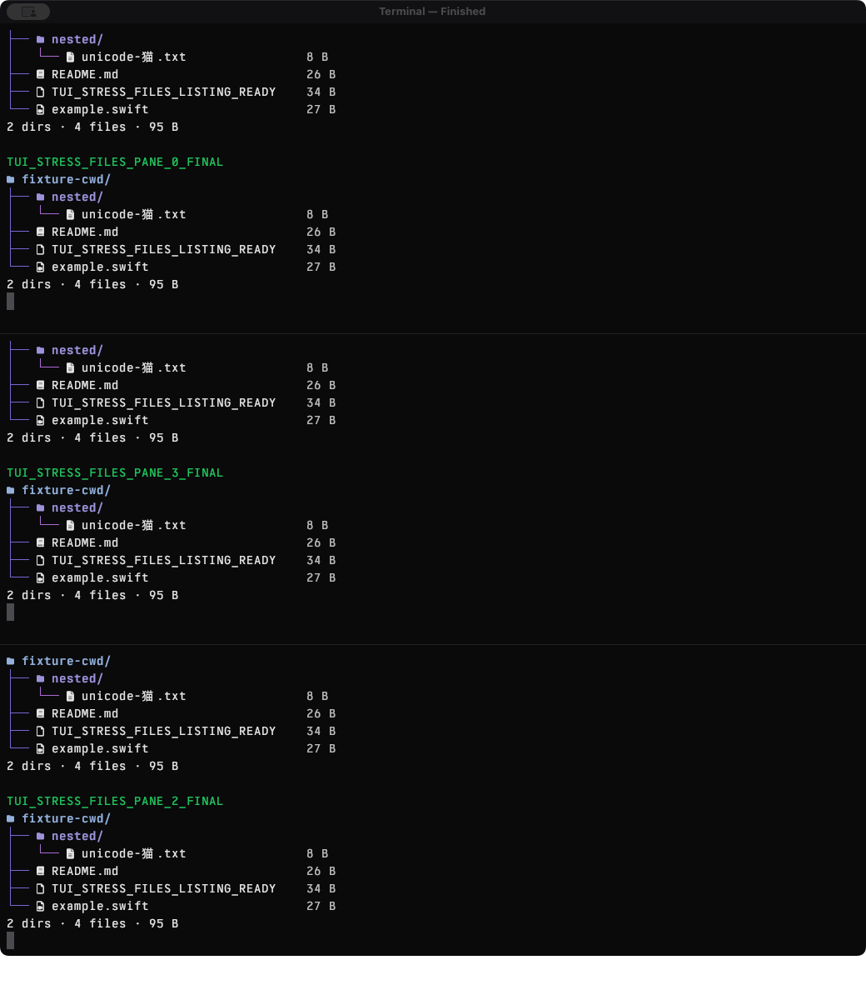
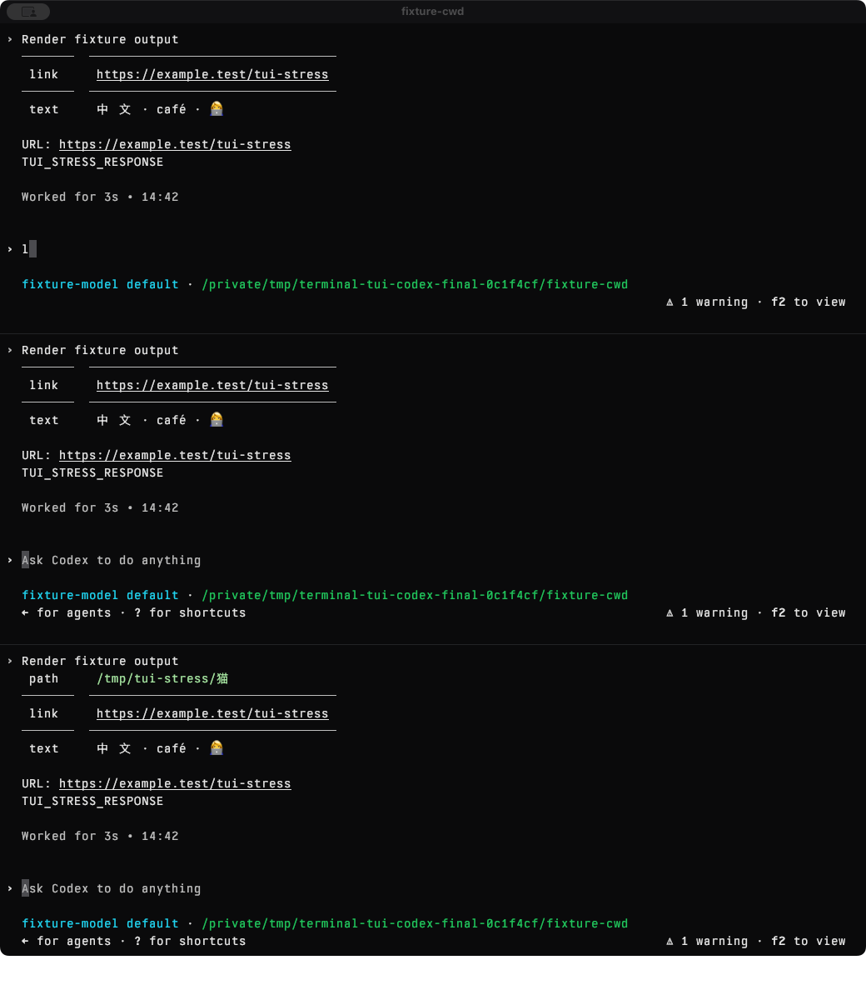

# Codex and Files pane stress

Verified on this Mac on 2026-11-09, using the same frozen, whole-module-optimized
0.2.3 build for both workloads. Production source and executable hashes, helper
hashes, geometry, cleanup receipts, and capture hashes are in
[verification.json](verification.json).

The headless macOS suite passes at `12330f0` in
[CI run 42630258871](https://github.com/HelgeSverre/terminal/actions/runs/42630258871).

| Workload | Rapid window resizes | Workload output during resizing | Final visible panes | Cleanup |
| --- | ---: | ---: | ---: | --- |
| Files 0.4.0 | 72 | 19,110 bytes | 3/3 | No survivors; 4 healthy fixture receipts |
| Codex 0.167.0 | 72 | 72,348 bytes | 3/3 | No survivors; 4 healthy fixture receipts |

Each run split right, split below, dragged both dividers, closed the spanning
right pane, recreated a split, dragged the window corner, and rapidly alternated
width and height. The final inspection expanded and balanced the three panes.
Every surviving pane emitted real workload output during the resize interval,
received changed PTY dimensions, and exposed its expected final content through
accessibility. Files ran repeatedly with ANSI colors and icons. The real Codex
UI consumed streamed Markdown, code, a table, CJK, combining text, emoji, and a
URL from a fixed local Responses provider; no external model service was used.

The investigation found two layout defects:

- Subdividing a minimum-height pane could create children of 119 and 0 points,
  although its ancestor had room. Splitting now allocates ancestor space before
  positioning the new divider. [Failing geometry](subdivide-before.json).
- Shrinking a valid window could leave nested panes at 77 and 76 points, below
  the 120-point minimum. Window resizing now reconciles the entire layout with a
  reentrancy guard. [Before](resize-before.json), [after](resize-after.json).

`just pane-lifecycle-smoke` exercises these actual AppKit paths, promotion,
attachment, containment, non-overlap, and shrink/grow minimums. It also runs in
`just check`, alongside the native renderer smoke on a local Mac. Hosted CI
runs the headless suite with `just test` under the existing virtual-GPU policy.
The initial attempt to run this GUI fixture there exited with SIGSEGV; no crash
report was retained, so its cause is unconfirmed. Headless fixture, provider,
driver-topology, provenance, capture-wait,
and child-cleanup checks run in `just workflow-tests`.

Use `just tui-stress files` or `just tui-stress codex` to repeat the desktop
diagnostic against a copied installed app matching its installation receipt.
Preparation and explicit frozen-build invocation are documented in
[the harness README](../../tools/tui_stress/README.md).

Contact sheets and full-size final frames were inspected without observing
stretched glyphs or missing expected colors in those samples. The automated
gates check workload execution, PTY geometry, accessibility content, pane layout,
and cleanup. They do not compare every Metal frame: the reused synthetic capture
marker classifier is inconclusive for these real workloads. Full recordings
remain in the private artifact directories listed in the verification receipt.

