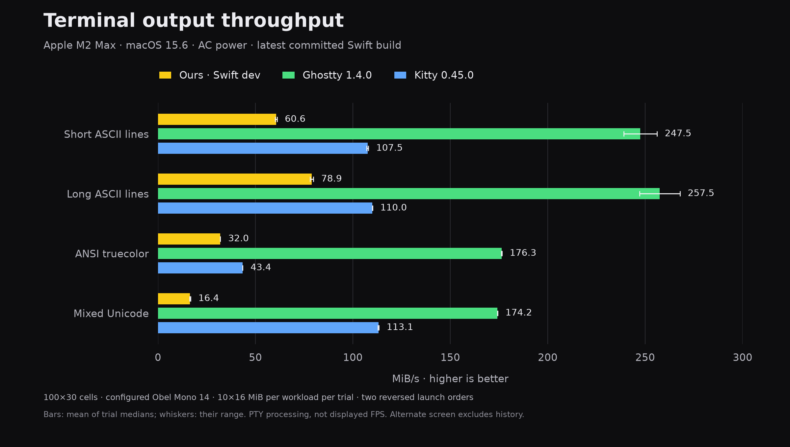

# Swift terminal, Ghostty and Kitty

Measured on the same Apple M2 Max, macOS 15.6, AC power. Our release-WMO Swift
development build includes the committed parser, Unicode, visible-link and PTY
read changes through `9354d3a`. Held ASCII/cluster/CSI experiments are excluded.
The references are the installed Ghostty 1.4.0 and Kitty 0.45.0.



Each workload runs ten 16 MiB samples in an opaque 100×30-cell window, configured
Obel Mono 14, with shell integration disabled. Apps run sequentially in two
opposite orders: ours–Ghostty–Kitty, then Kitty–Ghostty–ours. The alternate screen
excludes retained history. Each sample ends with an ordered cursor reply to
ensure processing has caught up.

| Workload | Ours MiB/s | Ghostty MiB/s | Kitty MiB/s | Ours / Ghostty | Ours / Kitty |
| --- | ---: | ---: | ---: | ---: | ---: |
| Short ASCII lines | 60.6 | 247.5 | 107.5 | 24.5% | 56.3% |
| Long ASCII lines | 78.9 | 257.5 | 110.0 | 30.6% | 71.7% |
| ANSI truecolor | 32.0 | 176.3 | 43.4 | 18.1% | 73.6% |
| Mixed Unicode | 16.4 | 174.2 | 113.1 | 9.4% | 14.5% |

Values are the mean of the two trial medians, not a pooled-sample median.
The paired trial medians are 60.10/61.08, 79.75/77.98, 32.00/31.91 and
16.16/16.69 for our app. Ghostty's ASCII medians vary by about 7–8%; the other
reference/workload pairs are steadier. Desktop load averages change from
6.12/5.31/5.28 to 5.38/5.29/5.28. This remains a desktop experiment rather than an
isolated laboratory ranking, but it is less variable than the preceding run.

All six app processes and their owned children exited naturally, with no
cleanup survivors. A separate 64 KiB preflight verified geometry and ownership
for every app in both orders before these timings. Kitty uses
[`macos_quit_when_last_window_closed`](https://sw.kovidgoyal.net/kitty/conf/#opt-kitty.macos_quit_when_last_window_closed)
so its disposable instance also exits with its final window.

This measures terminal processing and PTY backpressure, not displayed FPS,
interactive latency, visual correctness or SQL-history performance. Same cell
grid does not imply same raster workload: our canvas is 900×630 pixels,
Ghostty's 800×540 and Kitty's 900×540. Font settings match; independently
verified resolved-font equality is not claimed. Missing process counters in
the reference apps prevent a cross-app CPU/RAM claim.

`comparison.json` contains raw samples, process ownership, executable and driver
hashes, versions, geometry and launch order. `summary.json` contains the table
calculation. `build-provenance.json` records the WMO compiler/input identities.
Our executable was built at `96c2eb7`; subsequent commits through `9354d3a`
change tests and documentation only, so its application sources are identical.

```shell
just benchmark-terminals reports/terminal-comparison-next
```

The current runner owns launch, configuration, freezing, validation and cleanup
for all three apps. `just benchmark terminal|ghostty|kitty` remains the separate
manual single-app pilot, described in [benchmarking](../../docs/benchmarking.md).

To regenerate the chart from the saved observations:

```shell
cd reports/terminal-comparison-2026-11-09
uv run chart.py comparison.json
```

The plotting dependencies are pinned in `uv.lock`; Python is only needed to
regenerate this report's chart, not to build or run the terminal.
