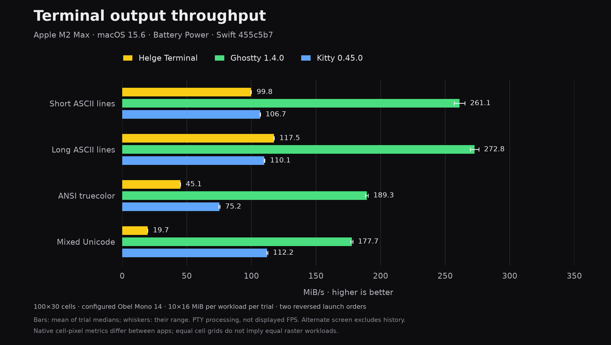

# Swift terminal, Ghostty and Kitty after the shared reader

Measured on the same Apple M2 Max and macOS 15.6, on battery power (15% at the
start). The app is the release-WMO build with the shared reader from `455c5b7`;
the comparison runner is committed at `c504a67`. The three rejected Unicode
experiments are excluded. References are Ghostty 1.4.0 and Kitty 0.45.0.

`app-provenance.json` distinguishes the application revision and packaged
executable from the runner revision and compiler output. The compiler artifact
is hashed before bundle signing; the measured app is hashed afterward.
`signature-payload-proof.json` verifies that only the signature blob and its
Mach-O size bookkeeping differ, using the retained `signature_payload.rb`.



| Workload | Helge Terminal, MiB/s | Ghostty, MiB/s | Kitty, MiB/s | Ours / Ghostty | Ours / Kitty |
| --- | ---: | ---: | ---: | ---: | ---: |
| Short ASCII lines | 99.8 | 261.1 | 106.7 | 38.2% | 93.5% |
| Long ASCII lines | 117.5 | 272.8 | 110.1 | 43.1% | 106.8% |
| ANSI truecolor | 45.1 | 189.3 | 75.2 | 23.8% | 59.9% |
| Mixed Unicode | 19.7 | 177.7 | 112.2 | 11.1% | 17.6% |

We are close to Kitty on these ASCII workloads and faster on long ASCII lines.
Ghostty remains substantially faster in all four workloads. Unicode is still
the largest gap; this result does not establish comparable Ghostty performance.

## Method

Each workload runs ten 16 MiB samples in a 100×30-cell window, configured
Obel Mono 14, with an opaque background and shell integration disabled. Apps
run sequentially in two reversed orders: ours–Ghostty–Kitty, then
Kitty–Ghostty–ours. Each sample ends with an ordered cursor reply. The alternate
screen excludes retained history.

Values are the mean of the two trial medians. Whiskers show their range, not a
confidence interval. Our trial medians are 100.01/99.53, 117.71/117.32,
45.17/44.98, and 19.78/19.70 MiB/s. Every app and owned child exits naturally
without cleanup survivors, both in the measured run and the separate 64 KiB
preflight. Raw samples, commands, hashes, versions, and lifecycle checks are
in `comparison.json`; `summary.json` contains the plotted values.

The input payload, driver, and cell grid are matched. Native cell-pixel sizes differ:
ours is 1700×1230, Ghostty 1700×1082, and Kitty 1700×1050. Configured font family
and size match; independently verified resolved-font equality is not claimed.
These results measure PTY processing and backpressure, not displayed FPS,
input-to-photon latency, peak memory, or SQL-history behavior. The desktop and
power mode are not laboratory-controlled. Battery state is recorded at the
start and in a separately timestamped snapshot after the comparison.

## Exact grid and retained failed attempts

The initial fixture opened Ghostty at 101 columns and Kitty at 102 on this
Retina display. The driver rejected both. A separate Ghostty probe verified
that zero horizontal padding restores 100×30; zero Kitty padding does the same.
The final six-app preflight independently verifies 100×30 in both orders.
These are disposable configurations; installed settings and live sessions
are not changed.

`rejected-101-columns` and `rejected-kitty-102-columns` retain the failed
attempts. Their results are excluded from the chart. `preflight/comparison.json`
records the successful configuration. The runner still rejects any grid or
ownership mismatch rather than accepting a different workload.

The [paired reader gate](../shared-pty-reader-649/README.md) separately measures
the change against the previous runtime, including input latency and the full
SQL dump with figure-eight window motion. Do not attribute differences from
the older three-app chart solely to code changes: display geometry, reference
padding, power, and desktop load differ between captures.

Regenerate this chart with the committed lockfile:

```shell
uv run --project reports/terminal-comparison-2026-11-10 \
  reports/terminal-comparison-2026-11-10/chart.py \
  reports/terminal-comparison-2026-11-10/comparison.json
```
