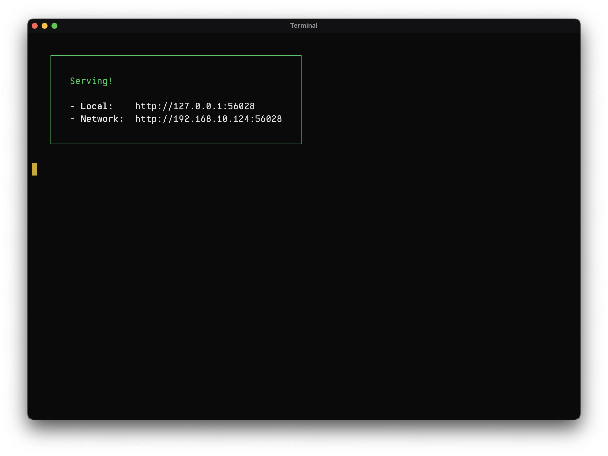
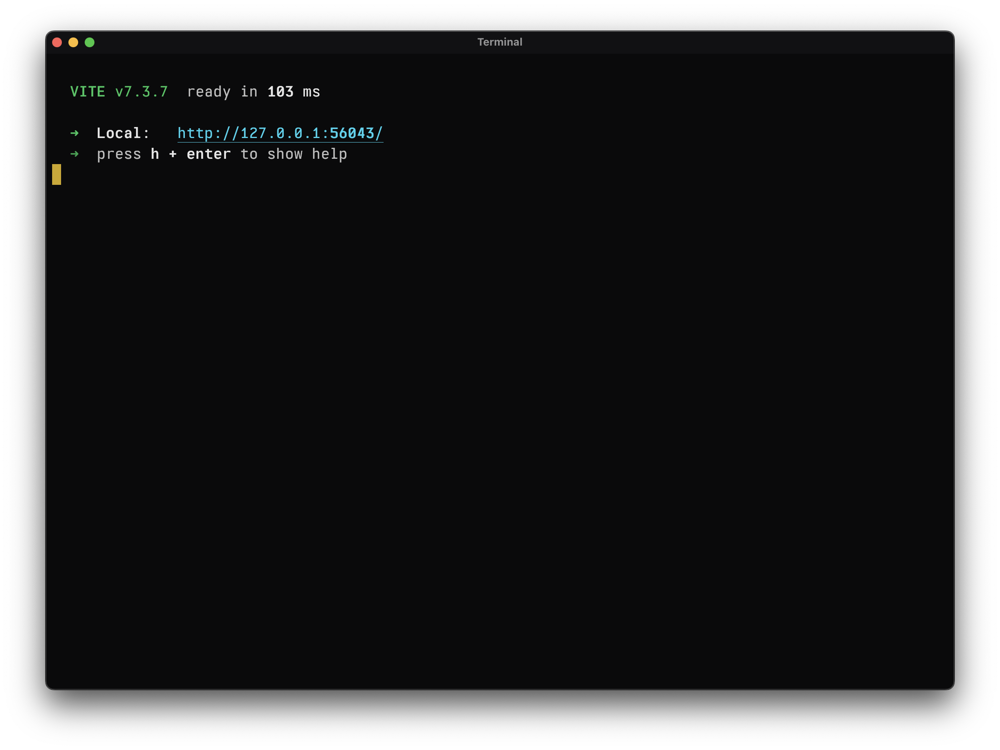

# Cmd-hover links

Actual PTY captures from `~/code/hanimex` show that Bun/serve 14.2.7 and
Vite 7.3.7 print plain URLs with zero OSC 8 annotations. Both archived Rust and
the installed Swift runtime only activated explicit OSC 8 links. This change
adds plain URL detection alongside that existing capability.

Hold Cmd over a URL to underline it and show a pointing-hand cursor; Cmd-click
opens its current target. One projection owns validation, soft-wrap joining,
wide-cell mapping and OSC 8 precedence. Accessibility uses those same links,
including cached AX children and stale-generation rejection. Candidate length,
occurrence count and grid indexing are bounded. Long-token scanning is
amortized; AX text ranges are indexed once rather than rescanning the grid.

## Verified

The frozen Preview03 uses committed `33f446b` emulator/session sources with
only the eight link-related files in `source.json` overlaid. The concurrent
resumable-reflow work is excluded. `build.json` identifies the WMO executable.

| Actual command | Native AppKit Cmd gesture → browser | agent-desktop AXPress → browser | Window close / children reaped |
|---|---|---|---|
| `bun x serve --no-clipboard --listen tcp://127.0.0.1:<port>` | Pass | Pass | Pass |
| `bun run dev --port <port> --strictPort` | Pass | Pass | Pass |

Each test uses a new port, observes the exact URL in Chrome across its running
processes, closes only its newly opened tab, and naturally closes/reaps its
owned terminal and server. The ad-hoc runtime-34 negative control receives the
same AppKit Cmd-down and does not open the plain serve URL.

`just visible-links-test` passes URL policy, OSC 8 precedence, Unicode/wide
mapping, soft/hard wrap, clipping, stale AX actions and large-input cases.
Single-run optimized diagnostics on this Mac:

| Case | Time |
|---|---:|
| 100×30 grid, 30 URLs | 1.81 ms |
| 1,048,576-cell grid | 290.06 ms |
| 1,048,576-cell non-delimited line | 246.53 ms |
| 4,096 AX links: construction | 68.83 ms |
| 4,096 AX links: attributed query and children | 19.99 ms |

These are diagnostic timings, not a main-thread latency acceptance result.
Very large presentation projections remain a responsiveness limitation.

## Scope

Native mouse-path proof injects an NSEvent through `NSApp.sendEvent` in a
private diagnostic build environment and verifies Canvas delivery plus actual
browser navigation. OS/HID mouse injection did not reliably deliver a mouse-down
and is inconclusive; no physical-input claim is made. Diagnostic code is not
part of the app source. The external agent-desktop AXPress tests use the normal
unmodified app executable.

Ghostty's Cmd-hover behavior is the user-confirmed reference. Its automated
browser-navigation attempt was inconclusive and is not counted as a passing
comparison. The original hardened-baseline injection attempt was also invalid
and is explicitly excluded in the retained artifacts. Full raw evidence and
frozen source are preserved by the hashed archive in `archive.json`.

